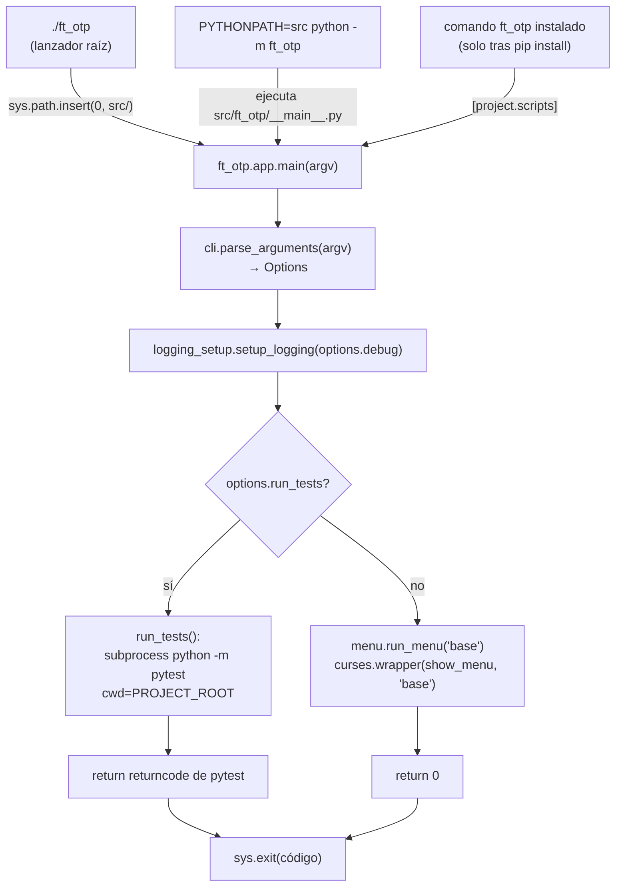

# Reestructuración de ft_otp: la estructura estándar de un proyecto Python

> Fecha: 2026-11-12 · Cambios cubiertos: reestructuración del esqueleto (de layout plano a *src layout*). El proyecto no es un repositorio Git, así que no hay commits: el estado "antes" procede de la descripción del cambio y el estado "después" se ha verificado leyendo los ficheros actuales.

## 1. ¿Qué se ha implementado?

No se ha añadido lógica nueva: `ft_otp` sigue sin generar contraseñas. Lo que ha cambiado es **cómo está organizado el código**. El proyecto ha pasado de una carpeta `src/` con módulos sueltos a la organización que usa la mayoría de proyectos Python modernos:

```
ft_otp/                      <- raíz del proyecto
├── ft_otp                   <- lanzador ejecutable (sin .py), lo pide el subject
├── pyproject.toml           <- descripción del proyecto y configuración de herramientas
├── .gitignore               <- qué no debe entrar nunca en Git
├── requirements.txt         <- (ya existía) pip freeze del entorno
├── src/
│   └── ft_otp/              <- el paquete Python de verdad
│       ├── __init__.py
│       ├── __main__.py
│       ├── app.py
│       ├── cli.py
│       ├── constants.py
│       ├── logging_setup.py
│       └── menu.py
└── tests/
    └── test_cli.py
```

Resumen de los cambios, y la razón de cada uno (se desarrollan en las secciones siguientes):

| Antes | Después | Por qué |
|---|---|---|
| `src/` sin `__init__.py`, imports `from src.tools import ...` | Paquete `src/ft_otp/` con `__init__.py`, imports `from ft_otp.cli import ...` | Un paquete con nombre propio, importable desde cualquier sitio e instalable |
| El fichero raíz `ft_otp` contenía el `main()` | `ft_otp` es solo un lanzador de 4 líneas útiles; `main()` vive en `app.py` | Separar "cómo se arranca" de "qué hace el programa" |
| `main() -> None`, llamado sin `sys.exit` | `main(argv) -> int` y `sys.exit(main())` | Los códigos de salida llegan al sistema operativo; `main` se puede testear |
| `TypedDict` cuyas claves no coincidían con las reales | `@dataclass(frozen=True) class Options` | Que el comprobador de tipos sirva de algo y no se pueda modificar por error |
| `nargs=1` en `-g` y `-k` (listas de un elemento) | Sin `nargs` (`str` o `None`) | El valor es una ruta, no una lista |
| `parse_args()` siempre leía `sys.argv` | `parse_arguments(argv)` | Poder probar el parser con listas inventadas |
| `tools.py` mezclaba logging y menú | `logging_setup.py` y `menu.py` | Un módulo, una responsabilidad |
| Diccionarios de menús creados en cada llamada | `MENUS` en `constants.py` | Un registro único, creado una sola vez |
| Sin tests, sin `pyproject.toml`, sin `.gitignore` | `tests/test_cli.py`, `pyproject.toml`, `.gitignore` | Herramientas estándar del ecosistema |

## 2. Tecnologías y conceptos implicados

Los conceptos están ordenados para que cada uno se apoye en los anteriores.

### 2.1. Módulo, paquete e `import`

- Un **módulo** (*module*) es un fichero `.py`. `cli.py` es el módulo `cli`.
- Un **paquete** (*package*) es una carpeta que agrupa módulos. `src/ft_otp/` es el paquete `ft_otp`, y `ft_otp.cli` es el módulo `cli` *dentro* de ese paquete.

Cuando escribes `from ft_otp.cli import parse_arguments`, Python no busca "en la carpeta actual" sin más: recorre, en orden, una lista de directorios llamada **`sys.path`** y se queda con la primera coincidencia de una carpeta `ft_otp/` (o un fichero `ft_otp.py`).

Analogía (solo como ayuda): `sys.path` es como la variable `PATH` de la shell. Cuando tecleas `ls`, la shell busca un ejecutable `ls` en cada directorio de `PATH`, en orden. Python hace lo mismo con los nombres de módulos y `sys.path`.

¿Qué hay en `sys.path`? Principalmente:

1. **El directorio del script** que has ejecutado (si haces `python algo/script.py`, entra `algo/`). Con `python -m`, entra el directorio actual.
2. Lo que pongas en la variable de entorno `PYTHONPATH`.
3. La biblioteca estándar y `site-packages` (donde `pip` instala cosas; con el venv activo, `.venv/lib/python3.12/site-packages`).

Esto explica casi todo lo que viene después. Puedes verlo tú mismo con `python -c "import sys; print(*sys.path, sep='\n')"`.

### 2.2. Paquete regular frente a *namespace package* (`__init__.py`)

- Un **paquete regular** (*regular package*) es una carpeta con un fichero `__init__.py`. Ese fichero se ejecuta la primera vez que se importa el paquete y marca la carpeta, sin ambigüedad, como "esto es un paquete".
- Un **namespace package** (*paquete de espacio de nombres*, PEP 420) es una carpeta **sin** `__init__.py` que Python acepta igualmente como paquete. Existe para un caso avanzado: repartir un mismo paquete entre varias carpetas o distribuciones.

Antes, `src/` no tenía `__init__.py`, así que `import src.tools` funcionaba como *namespace package* de forma implícita. Funcionaba, pero:

- El paquete se llamaba `src`, un nombre genérico que no dice nada y que muchos proyectos usan; no es algo que se pueda instalar.
- Solo funcionaba si la **raíz del proyecto** estaba en `sys.path`. Al ejecutar `./ft_otp` eso se cumplía (el directorio del script entra en `sys.path`), pero en otros contextos (otra herramienta, otro directorio de trabajo, un test) dependía de dónde estuvieras.
- Las herramientas de empaquetado (`setuptools`, en `pyproject.toml` usa `packages.find`) buscan por defecto paquetes regulares, con `__init__.py`.

Ahora `src/ft_otp/__init__.py` existe y además guarda la versión:

```python
"""ft_otp: TOTP (RFC 6238) generator built on HOTP (RFC 4226)."""

__version__ = "0.1.0"
```

(`src/ft_otp/__init__.py`). Es una convención: `import ft_otp; ft_otp.__version__` devuelve la versión.

### 2.3. El *src layout*

Hay dos formas habituales de colocar un paquete:

- **Flat layout**: `proyecto/ft_otp/__init__.py`, el paquete directamente en la raíz.
- **Src layout**: `proyecto/src/ft_otp/__init__.py`, el paquete dentro de una carpeta `src/`.

¿Por qué meterlo en `src/`? Por el punto 1 de `sys.path`: el directorio actual o del script suele estar en `sys.path`. En un *flat layout*, si ejecutas los tests desde la raíz, `import ft_otp` encuentra **la carpeta del repositorio** aunque el paquete instalado sea distinto o esté roto; los tests pasan "por accidente". En un *src layout* el paquete **no** está en la raíz, así que solo se puede importar si alguien lo ha hecho importable a propósito (instalándolo, con `PYTHONPATH=src`, con la configuración de pytest o con el lanzador). Las importaciones se vuelven explícitas y predecibles.

La guía oficial de empaquetado de Python compara ambos y recomienda el *src layout* por esto mismo (enlace en la sección 8).

Detalle importante en este proyecto: el fichero raíz se llama `ft_otp` **sin extensión `.py`**. Como Python solo importa ficheros `.py` (y carpetas), ese fichero nunca puede confundirse con el paquete `ft_otp`. Si se llamara `ft_otp.py` y la raíz estuviera en `sys.path` por delante de `src/`, `import ft_otp` cargaría el lanzador en vez del paquete.

### 2.4. Códigos de salida (*exit codes*)

Todo proceso termina devolviendo un número al sistema operativo: `0` significa éxito; cualquier otro valor, algún tipo de fallo. La shell lo guarda en `$?`:

```bash
./ft_otp --help; echo $?     # 0
./ft_otp --bogus; echo $?    # 2  (argparse usa 2 para errores de uso)
```

(Comprobado ejecutando ambos comandos.)

En Python, `sys.exit(n)` termina el programa con el código `n`. Detalles útiles: `sys.exit(None)` equivale a `0`, y si el programa simplemente llega al final, también sale con `0`. Por eso, en la versión anterior, `main()` devolvía el resultado de `subprocess.run(...)` (un objeto `CompletedProcess`), pero nadie lo usaba: `./ft_otp -t` salía siempre con `0`, **aunque fallaran los tests**. Un script, un Makefile o una CI que preguntara "¿han pasado los tests?" recibía siempre un "sí".

### 2.5. Punto de entrada (*entry point*)

Un **punto de entrada** es la función por la que empieza a ejecutarse el programa. Aquí es `ft_otp.app.main`. Lo interesante es que hay **tres caminos distintos** para llegar a ella, y todos acaban llamando a la misma función:

1. `./ft_otp` (el lanzador de la raíz), que es lo que exige el subject.
2. `python -m ft_otp`, gracias a `__main__.py`.
3. Un comando `ft_otp` instalado por `pip`, gracias a `[project.scripts]` en `pyproject.toml`.

Se explican uno a uno en la sección 3.

### 2.6. `pyproject.toml`

Es el fichero estándar (PEP 518 y PEP 621) donde se describe un proyecto Python: cómo construirlo, cómo se llama, qué versión de Python necesita, qué dependencias tiene y qué comandos instala. Además, muchas herramientas (pytest, ruff, mypy...) leen su configuración de secciones `[tool.<herramienta>]` dentro de él, así que todo queda en un sitio. Está escrito en formato TOML (un formato de configuración de clave = valor con secciones entre corchetes).

### 2.7. `dataclass` congelada

Una `dataclass` es una clase normal a la que el decorador `@dataclass` le genera automáticamente `__init__`, `__repr__` y `__eq__` a partir de los atributos anotados. Con `frozen=True`, intentar asignar un atributo después de crear el objeto lanza `FrozenInstanceError`: el objeto es de solo lectura. Se explica en contexto en la sección 3.4.

## 3. Entendiendo la implementación

### 3.1. El lanzador `ft_otp` (raíz)

```python
#!/usr/bin/env python3
"""Launcher for ft_otp: runs the package from src/ without installing it."""

import sys
from pathlib import Path

sys.path.insert(0, str(Path(__file__).resolve().parent / "src"))

from ft_otp.app import main  # noqa: E402

if __name__ == "__main__":
    sys.exit(main())
```

Línea a línea, lo que importa:

- `#!/usr/bin/env python3`: el *shebang*. Cuando haces `./ft_otp`, el kernel lee esta línea y ejecuta el fichero con el primer `python3` que encuentre en tu `PATH` (con el venv activo, el del venv). El fichero tiene permiso de ejecución (`-rwxrwxr-x`).
- `Path(__file__).resolve().parent / "src"`: `__file__` es la ruta de este fichero; `.resolve()` la convierte en absoluta y resuelve enlaces simbólicos; `.parent` es la raíz del proyecto; `/ "src"` añade `src`. Resultado: la ruta absoluta de `src/`, **independiente del directorio desde el que lances el programa**.
- `sys.path.insert(0, ...)`: pone `src/` al **principio** de `sys.path`, para que `import ft_otp` encuentre `src/ft_otp/` antes que cualquier otra cosa.
- `# noqa: E402`: los linters (flake8, ruff) avisan con el código E402 cuando hay un `import` que no está al principio del fichero. Aquí es intencionado (el import tiene que ir *después* de modificar `sys.path`), y el comentario silencia el aviso.
- `if __name__ == "__main__":`: `__name__` vale `"__main__"` cuando el fichero se ejecuta directamente, y otro valor si se importa. Es la protección habitual para no ejecutar nada al importar.
- `sys.exit(main())`: el entero que devuelve `main` se convierte en el código de salida del proceso.

**Por qué existe.** El subject exige un ejecutable llamado `ft_otp` que se pueda lanzar como `./ft_otp` sin instalar nada. Con un *src layout*, el paquete no está en `sys.path` por defecto, así que el lanzador lo añade a mano.

**Por qué es tan delgado.** Toda la lógica está en el paquete. Así los otros dos caminos (`python -m` y el comando instalado) se comportan exactamente igual, y los tests importan el mismo código que se ejecuta.

**El compromiso, dicho con honestidad.** Modificar `sys.path` a mano es un apaño pragmático. Lo "canónico" sería instalar el paquete (`pip install -e .`) y usar el comando que crea `pip`. Pero eso contradice el requisito de no instalar nada, así que este lanzador es una solución razonable a un requisito externo, no un patrón para copiar en cualquier proyecto.

### 3.2. `__main__.py`: `python -m ft_otp`

```python
"""Allow running the package with `python -m ft_otp`."""

import sys

from ft_otp.app import main

sys.exit(main())
```

`python -m nombre` significa "busca el módulo o paquete `nombre` en `sys.path` y ejecútalo como programa". Si `nombre` es un paquete, Python ejecuta su `__main__.py`. Es el mismo mecanismo que usas con `python -m pytest` o `python -m venv`.

Como el paquete no está instalado, hay que decirle a Python dónde está: `PYTHONPATH=src python -m ft_otp` (comprobado: muestra la misma ayuda que `./ft_otp`). Aquí no hace falta `if __name__ == "__main__"` porque este fichero solo existe para ejecutarse como programa.

### 3.3. `app.py`: `main(argv) -> int`

```python
def run_tests() -> int:
    """Run the test suite with pytest and return its exit code."""
    result = subprocess.run(
        [sys.executable, "-m", "pytest"],
        cwd=PROJECT_ROOT,
        check=False,
    )
    return result.returncode


def main(argv: Sequence[str] | None = None) -> int:
    """Run ft_otp and return the process exit code."""
    options = parse_arguments(argv)
    setup_logging(options.debug)

    if options.run_tests:
        return run_tests()

    run_menu("base")  # only option for now is EXIT
    return 0
```

(`src/ft_otp/app.py:13-32`)

Las decisiones:

- **Devuelve `int`.** `main` no termina el proceso: devuelve un número y quien la llama decide qué hacer con él (`sys.exit`). Esto separa la lógica de la terminación del proceso, y permite que un test haga `assert main([...]) == 0` sin que el test se cierre.
- **`run_tests` devuelve `result.returncode`**, el código de salida de pytest (0 si todo pasa, 1 si falla algún test, etc.). Ese número sube por `main` hasta `sys.exit`, así que ahora `./ft_otp -t; echo $?` refleja de verdad el resultado.
- **`sys.executable`** es la ruta del intérprete que está ejecutando el programa. Usarlo en vez de `"python"` garantiza que pytest se lance con el mismo Python (y el mismo venv). Ojo: si ese Python no tiene pytest instalado, fallará.
- **`cwd=PROJECT_ROOT`** lanza pytest desde la raíz del proyecto, donde está `pyproject.toml`. Así pytest encuentra su configuración aunque tú ejecutes `./ft_otp -t` desde otra carpeta.
- **`check=False`** es el valor por defecto; escribirlo deja claro que un fallo de pytest **no** debe lanzar una excepción (`CalledProcessError`), sino devolverse como código.
- **`argv: Sequence[str] | None = None`**: si no se pasa nada, se usará `sys.argv` (ver 3.4). `Sequence` (de `collections.abc`) acepta listas, tuplas, etc.

Un cambio pequeño respecto al antes: ahora `setup_logging` se llama **antes** de comprobar `-t` (antes se configuraba después). No cambia nada visible hoy, pero significa que `--debug` también afecta al camino de los tests. Además, el valor que devuelve `run_menu` ya no se compara con `EXIT`: con un único menú cuya única opción es salir, el resultado era siempre el mismo, y el comentario lo indica.

### 3.4. `cli.py`: de `TypedDict` roto a `dataclass` congelada

**El problema de antes.** Un `TypedDict` declara qué claves y tipos tiene un diccionario, para que un comprobador de tipos (mypy, Pyright) avise si te equivocas. El código anterior declaraba:

```python
# Versión anterior (reconstruida a partir de la descripción, no es el código actual)
class Options(TypedDict):
    KEY_TO_STORE: str
    KEY_FILE: str
    DEBUG: bool
    RUN_TESTS: bool
```

Eso declara claves **literales** `"KEY_TO_STORE"`, `"DEBUG"`... Pero el diccionario se construía con las *constantes* como claves, cuyos valores eran `"Key to store"`, `"debug"`, `"Run tests"`... Las claves reales nunca coincidían con las declaradas, así que el comprobador de tipos no podía ayudar en nada (o se quejaba de todo). Además, por `nargs=1` los valores eran listas de un elemento, no `str`.

**La solución actual.**

```python
@dataclass(frozen=True)
class Options:
    """Parsed command-line options."""

    key_to_store: str | None
    key_file: str | None
    interface: bool
    run_tests: bool
    debug: bool
```

(`src/ft_otp/cli.py:8-16`)

- Se accede con atributos (`options.debug`) en vez de `options[DEBUG]`. Si escribes `options.degub`, el editor y el comprobador de tipos lo detectan; con claves de diccionario en forma de cadena, el error solo aparece en tiempo de ejecución.
- `str | None`: si no se pasa `-g`, el valor es `None`. El tipo obliga a recordar ese caso.
- `frozen=True`: las opciones se leen de la línea de comandos una vez y no deberían cambiar después. Congelar el objeto convierte una modificación accidental en un error inmediato.
- `interface` ahora está incluido (antes `-i` se parseaba pero se descartaba).
- Como una `dataclass` genera `__eq__`, dos `Options` con los mismos valores son iguales. Lo aprovecha el test `test_defaults`.

**`build_parser` y `parse_arguments`.**

```python
def parse_arguments(argv: Sequence[str] | None = None) -> Options:
    """Parse argv (defaults to sys.argv[1:]) into an Options object."""
    args = build_parser().parse_args(argv)
    return Options(
        key_to_store=args.generate,
        ...
```

(`src/ft_otp/cli.py:57-66`, fragmento)

La clave está en `parse_args(argv)`: según la documentación de `argparse`, si `argv` es `None`, lee `sys.argv[1:]`; si es una lista, usa esa lista. Así, en producción no pasas nada y se usa la línea de comandos real, y en un test pasas `["-g", "key.hex"]` sin tocar `sys.argv`. Esto es **inyección de dependencias** (*dependency injection*) en su forma más simple: en lugar de que la función vaya a buscar sus datos a un sitio global, se los das como parámetro.

`build_parser` está separado para poder obtener el parser por sí solo (por ejemplo, para imprimir la ayuda o probarlo aparte).

Otros detalles del parser:

- **Sin `nargs=1`.** Con `nargs=1`, `argparse` guarda `["key.hex"]` (una lista). Sin `nargs`, una opción que recibe valor guarda directamente `"key.hex"`. El código que use la ruta no tiene que hacer `[0]`.
- **`--run-tests` en *kebab-case*** (palabras separadas por guiones). Es la convención de las opciones largas en la línea de comandos (`--dry-run`, `--no-cache`). `argparse` convierte los guiones en guiones bajos para el atributo: `--run-tests` se lee como `args.run_tests`.
- **`metavar="FILE"`** solo cambia cómo aparece el argumento en la ayuda: `-g FILE` en vez de `-g GENERATE`.
- **`prog="ft_otp"`** fija el nombre que aparece en `usage:` y en los mensajes de error (`ft_otp: error: unrecognized arguments: --bogus`), sea cual sea el camino de arranque. Sin él, con `python -m ft_otp` aparecería un nombre distinto (normalmente `__main__.py`). El subject pide mensajes de error con el formato `./ft_otp: error: ...` para la clave inválida; eso todavía no está implementado.

### 3.5. `logging_setup.py`: por qué no se llama `logging.py`

```python
import logging

DEBUG_FORMAT = "%(levelname)s: %(message)s [%(filename)s:%(lineno)d]"


def setup_logging(debug: bool) -> None:
    """Configure the root logger: DEBUG with file/line info, or INFO."""
    if debug:
        logging.basicConfig(level=logging.DEBUG, format=DEBUG_FORMAT)
    else:
        logging.basicConfig(level=logging.INFO)
```

(`src/ft_otp/logging_setup.py`)

Llamar a un módulo propio igual que uno de la biblioteca estándar (*shadowing*, "hacer sombra") es una fuente clásica de errores: si un fichero `logging.py` queda en un directorio que está en `sys.path` por delante de la biblioteca estándar, `import logging` cargará el tuyo. Dentro de un paquete el riesgo es menor (sería `ft_otp.logging`), pero el nombre `logging_setup` evita cualquier confusión, también al leer el código. El antiguo `tools.py` era un cajón de sastre; ahora cada módulo dice lo que hace.

`logging.basicConfig` configura el *root logger* (el registrador raíz del que heredan todos). En modo debug añade nivel, fichero y línea de cada mensaje. También se eliminaron los `logger` que se declaraban y nunca se usaban.

### 3.6. `constants.py`: `PROJECT_ROOT` y el registro `MENUS`

```python
PROJECT_ROOT = Path(__file__).resolve().parents[2]

# Menu actions
EXIT = "Exit"

# Menus: name -> (prompt, options)
MENUS: dict[str, tuple[str, list[str]]] = {
    "base": ("exit from this menu\n\n", [EXIT]),
}
```

**`PROJECT_ROOT`**, contando desde el fichero:

```
.../ft_otp/src/ft_otp/constants.py   <- __file__
.../ft_otp/src/ft_otp                <- parents[0]
.../ft_otp/src                       <- parents[1]
.../ft_otp                           <- parents[2]  = PROJECT_ROOT
```

Se calcula a partir de la ubicación del fichero, no del directorio actual, así que es estable vengas de donde vengas. Lo usa `run_tests` (sección 3.3).

**`MENUS`** es un registro a nivel de módulo (*module-level registry*): un diccionario que asocia el nombre de un menú con su texto y sus opciones. Antes, `menu()` creaba los diccionarios `menus` y `prompts` en cada llamada, y el texto y las opciones de un mismo menú estaban en dos diccionarios distintos. Ahora:

- Se crea una sola vez, al importar el módulo.
- Cada menú es una tupla `(prompt, options)`: lo que va junto está junto.
- Añadir un menú es añadir una línea de datos, sin tocar la lógica de `menu.py`.

Las claves de opción que había antes (`KEY_TO_STORE = "Key to store"`, etc.) desaparecen porque ya no hacen falta: los atributos de `Options` las sustituyen.

### 3.7. `menu.py`: aritmética modular y `curses.wrapper`

```python
ENTER_KEYS = (curses.KEY_ENTER, 10, 13)


def select(stdscr: curses.window, prompt: str, options: list[str]) -> int:
    ...
        key = stdscr.getch()
        if key == curses.KEY_UP:
            selected = (selected - 1) % len(options)
        elif key == curses.KEY_DOWN:
            selected = (selected + 1) % len(options)
        elif key in ENTER_KEYS:
            return selected
```

(`src/ft_otp/menu.py:7-27`, fragmento)

**`curses`** es la biblioteca estándar para dibujar interfaces de texto en la terminal (mover el cursor, leer teclas una a una). `stdscr` es la "ventana" que ocupa toda la terminal y `getch()` espera a que se pulse una tecla y devuelve su código.

**Wrap-around con `%`.** El operador módulo devuelve el resto de la división, y en Python el resultado tiene el signo del divisor, así que nunca es negativo con un divisor positivo. Con 3 opciones:

- Bajar desde la última: `(2 + 1) % 3 == 0` → vuelve a la primera.
- Subir desde la primera: `(0 - 1) % 3 == 2` → salta a la última.

Hace lo mismo que los dos `if selected < 0` / `if selected >= len(...)` de antes, en una sola expresión. (En C, `-1 % 3` vale `-1`; en Python vale `2`. Es un detalle a tener en cuenta si vienes de C.)

**`ENTER_KEYS`.** Según la terminal, Enter puede llegar como `curses.KEY_ENTER`, `10` (`\n`) o `13` (`\r`). Ponerlos en una tupla con nombre explica qué significan esos números mágicos y permite `key in ENTER_KEYS`.

**`curses.wrapper(show_menu, name)`.**

```python
def run_menu(name: str) -> str:
    """Open a curses session, show the menu `name`, return the choice."""
    return curses.wrapper(show_menu, name)
```

`curses.wrapper(func, *args)` prepara la terminal, llama a `func(stdscr, *args)` y, **pase lo que pase (incluso una excepción)**, la deja como estaba; luego devuelve lo que devolvió `func`. Sin él, un error a mitad del menú puede dejar la terminal "rota" (sin eco, sin saltos de línea). Antes se usaba `lambda stdscr: menu(stdscr, options)` para colar el argumento extra; como `wrapper` ya acepta argumentos adicionales, la lambda sobraba.

**`curses.window` en las anotaciones** documenta qué tipo es `stdscr` (comprobado: existe en Python 3.12 como `_curses.window`).

### 3.8. `pyproject.toml`, sección por sección

```toml
[build-system]
requires = ["setuptools>=68"]
build-backend = "setuptools.build_meta"
```
Qué herramienta construye el paquete cuando alguien hace `pip install .`. `pip` instala `setuptools` en un entorno temporal y le pide que construya.

```toml
[project]
name = "ft_otp"
version = "0.1.0"
description = "TOTP (RFC 6238) generator built on HOTP (RFC 4226)"
requires-python = ">=3.12"
dependencies = []
```
Los metadatos (PEP 621). `dependencies = []`: el programa no necesita nada fuera de la biblioteca estándar para ejecutarse. `requires-python` hace que `pip` se niegue a instalarlo en un Python más antiguo.

```toml
[project.optional-dependencies]
dev = ["pytest"]
```
Dependencias opcionales que solo necesita quien desarrolla: `pip install -e ".[dev]"` instalaría también pytest.

```toml
[project.scripts]
ft_otp = "ft_otp.app:main"
```
El tercer *entry point*: al instalar el paquete, `pip` crea un ejecutable `ft_otp` en `.venv/bin/` que importa `ft_otp.app` y hace, en esencia, `sys.exit(main())`. Por eso `main` devuelve un `int`: encaja directamente con este mecanismo.

```toml
[tool.setuptools.packages.find]
where = ["src"]
```
Le dice a setuptools que busque los paquetes dentro de `src/` (el *src layout*).

```toml
[tool.pytest.ini_options]
testpaths = ["tests"]
pythonpath = ["src"]
```
Configuración de pytest. `testpaths`: dónde buscar tests si ejecutas `pytest` sin argumentos. `pythonpath`: directorios que pytest añade a `sys.path` antes de ejecutar los tests. Gracias a esto, `tests/test_cli.py` puede hacer `from ft_otp.cli import ...` **sin instalar el paquete**: es el equivalente, para pytest, de lo que hace el lanzador para `./ft_otp`.

Actualmente el paquete **no** está instalado en el venv (comprobado con `pip show ft_otp`: no encontrado). Todo funciona sin instalar gracias al lanzador y a `pythonpath`.

### 3.9. `.gitignore`

```
.venv/
__pycache__/
*.pyc
.pytest_cache/
*.egg-info/
build/
dist/

# Encrypted key produced by `ft_otp -g`
ft_otp.key
```

Lista de rutas que Git no debe seguir. Todo lo que aparece es **generado**, no código fuente: el entorno virtual (pesado y específico de cada máquina; se reconstruye con `requirements.txt`), los bytecodes compilados (`__pycache__/`, `*.pyc`), la caché de pytest y los artefactos de construcción (`*.egg-info/`, `build/`, `dist/`).

La línea más importante en un proyecto de ciberseguridad es la última. `ft_otp.key` contendrá la clave secreta de la que salen las contraseñas de un solo uso. Aunque esté cifrada, subirla a un repositorio la expone para siempre (el historial de Git conserva los ficheros aunque luego se borren). El `.gitignore` se ha creado *antes* de que exista el fichero, que es el momento correcto. Por la misma razón, conviene tratar igual los ficheros de clave en hexadecimal que uses para probar (`key.hex` o similar): ahora mismo **no** están en el `.gitignore`.

### 3.10. `tests/test_cli.py`

```python
def test_defaults() -> None:
    assert parse_arguments([]) == Options(
        key_to_store=None,
        key_file=None,
        interface=False,
        run_tests=False,
        debug=False,
    )
```

pytest descubre los ficheros `test_*.py` y ejecuta las funciones `test_*`. Un `assert` que falla hace fallar el test.

Fíjate en `parse_arguments([])`: la lista vacía simula "el usuario no pasó ninguna opción". Sin el parámetro `argv`, este test leería el `sys.argv` real, que dentro de pytest contiene los argumentos **de pytest**, y el resultado dependería de cómo hayas lanzado los tests. El test compara con un `Options` completo gracias al `__eq__` generado por la `dataclass`.

Los otros dos tests comprueban que `-g` y `-k` producen una cadena (no una lista, la regresión del antiguo `nargs=1`) y que los tres *flags* se activan.

He ejecutado `.venv/bin/python -m pytest` desde la raíz: **3 passed**.

## 4. Flujo de ejecución

Los tres caminos de arranque convergen en la misma función:



Paso a paso con `./ft_otp -t` lanzado desde `/tmp`:

1. El kernel lee el shebang y arranca `python3` con el fichero `ft_otp`.
2. El lanzador calcula `<raíz>/src` a partir de `__file__` (no de `/tmp`) y lo pone primero en `sys.path`.
3. `from ft_otp.app import main` encuentra `src/ft_otp/app.py`, que a su vez importa `cli`, `constants`, `logging_setup` y `menu`. Al importar `constants`, se crean `PROJECT_ROOT` y `MENUS`.
4. `main()` recibe `argv=None`, así que `parse_args(None)` lee `sys.argv[1:]` = `["-t"]` → `Options(..., run_tests=True, ...)`.
5. Se configura el logging en nivel INFO.
6. `run_tests()` lanza `python -m pytest` con `cwd=<raíz>`; pytest lee `pyproject.toml`, añade `src` a su `sys.path` y ejecuta `tests/`.
7. Si un test falla, pytest sale con `1`; ese `1` vuelve como `returncode`, sale de `main` y llega a `sys.exit(1)`. La shell ve `$? = 1`.

## 5. Decisiones técnicas importantes

Las razones de esta sección proceden de la descripción del cambio y de `MEMORY.md`. Las ventajas y limitaciones que añado son mi interpretación.

- **Src layout + lanzador.** Ventaja: imports explícitos, paquete instalable, tests que prueban el paquete y no "lo que haya en la carpeta". Limitación: el lanzador manipula `sys.path`, un apaño justificado solo por el requisito de "sin instalar".
- **`main` devuelve un `int`.** Ventaja: códigos de salida correctos y `main` testeable. Al modificarla: cada camino nuevo (`-g`, `-k`) debería devolver un código (por ejemplo, distinto de 0 si la clave es inválida), no llamar a `sys.exit` desde dentro.
- **`Options` como `dataclass` congelada.** Al añadir una opción nueva hay que tocar tres sitios: `build_parser`, la clase `Options` y la construcción en `parse_arguments`. Si olvidas uno, la creación de `Options` falla enseguida (falta o sobra un argumento), lo cual es bueno.
- **Registro `MENUS`.** Alternativa más elaborada: una clase o `dataclass` por menú. Para un menú con una opción, el diccionario de tuplas es suficiente.
- **`PROJECT_ROOT` con `parents[2]`.** Depende de que `constants.py` esté exactamente dos niveles por debajo de la raíz. Si mueves el fichero, cambia el índice.

## 6. Ejemplos prácticos

| Llamada | Resultado |
|---|---|
| `parse_arguments([])` | `Options(key_to_store=None, key_file=None, interface=False, run_tests=False, debug=False)` |
| `parse_arguments(["-g", "key.hex"]).key_to_store` | `"key.hex"` (antes habría sido `["key.hex"]`) |
| `parse_arguments(["--run-tests"]).run_tests` | `True` |
| `./ft_otp --help; echo $?` | ayuda y `0` |
| `./ft_otp --bogus; echo $?` | `ft_otp: error: unrecognized arguments: --bogus` y `2` |
| `(0 - 1) % 1` en el menú `"base"` | `0`: con una sola opción, las flechas no se mueven |
| `Path(".../ft_otp/src/ft_otp/constants.py").resolve().parents[2]` | `.../ft_otp` |

Un experimento útil para entender `sys.path`: desde la raíz, ejecuta `.venv/bin/python -c "import ft_otp"`. Fallará con `ModuleNotFoundError`, porque la raíz no contiene ningún paquete `ft_otp` (el fichero `ft_otp` no tiene `.py`). Luego prueba `PYTHONPATH=src .venv/bin/python -c "import ft_otp; print(ft_otp.__version__)"`. Ese contraste es exactamente lo que resuelve el *src layout*.

## 7. ¿Qué debo recordar?

- `import` busca en `sys.path`, en orden. Casi todos los problemas de "no encuentra el módulo" se explican mirando `sys.path`.
- El paquete real es `src/ft_otp/`. El fichero raíz `ft_otp`, `__main__.py` y `[project.scripts]` son tres puertas que llevan a la misma habitación: `ft_otp.app.main`.
- Para ejecutar sin instalar: `./ft_otp` (el lanzador añade `src/`), `PYTHONPATH=src python -m ft_otp`, o los tests (pytest añade `src/` por `pythonpath`).
- `main` **devuelve** un código y solo el punto de arranque llama a `sys.exit`. Mantén esa regla al implementar `-g` y `-k`.
- Las funciones que leen datos externos (como `argv`) los reciben como parámetro con un valor por defecto: así se pueden probar.
- `ft_otp.key` nunca debe entrar en Git.

## 8. Para seguir aprendiendo

- Guía oficial de empaquetado: [src layout vs flat layout](https://packaging.python.org/en/latest/discussions/src-layout-vs-flat-layout/) y [Writing your pyproject.toml](https://packaging.python.org/en/latest/guides/writing-pyproject-toml/).
- Documentación de Python: [el sistema de importación (paquetes regulares y namespace packages)](https://docs.python.org/3/reference/import.html#packages), [`__main__`](https://docs.python.org/3/library/__main__.html), [`sys.path`](https://docs.python.org/3/library/sys_path_init.html).
- [`argparse`](https://docs.python.org/3/library/argparse.html) y [`dataclasses`](https://docs.python.org/3/library/dataclasses.html).
- pytest: [buenas prácticas de integración (layout de tests)](https://docs.pytest.org/en/stable/explanation/goodpractices.html).

## Limitaciones y puntos sin verificar

- **No hay historial Git**: el código "antes" no se ha podido leer; se describe a partir del resumen del cambio. El fragmento del `TypedDict` antiguo es una reconstrucción, no una copia.
- **`PROJECT_ROOT` y una instalación no editable**: con `pip install .` (no `-e`), `constants.py` se copiaría a `site-packages/ft_otp/`, y `parents[2]` apuntaría a una carpeta dentro de `.venv`, no al proyecto, por lo que `ft_otp -t` lanzaría pytest en un directorio sin `pyproject.toml` ni `tests/`. Con el lanzador o con `pip install -e .` no ocurre. No lo he ejecutado (no puedo instalar paquetes); es un razonamiento a partir del código.
- **`-t` depende del intérprete**: `run_tests` usa `sys.executable`; si `./ft_otp` se lanza con un `python3` del sistema sin pytest (venv no activado), fallará.
- **Funcionalidad pendiente**: `-g`, `-k` e `-i` se parsean pero no hacen nada; `main` siempre abre el menú salvo con `-t`. El mensaje de error del subject (`./ft_otp: error: key must be 64 hexadecimal characters.`) aún no existe.
- **No comprobado**: el menú curses (requiere una terminal interactiva) y el comando instalado por `[project.scripts]`. Sí comprobado: los 3 tests pasan, `./ft_otp --help` sale con 0, una opción desconocida sale con 2 y `PYTHONPATH=src python -m ft_otp -h` funciona.
