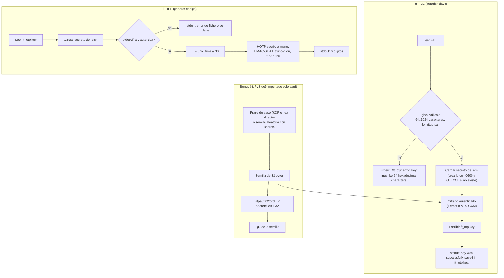

# Conceptos para rediseñar ft_otp: bytes, HMAC, HOTP, TOTP, cifrado, sales y PySide6

> Fecha: 2026-11-14 · Cambios cubiertos: ninguno. Es una **lección de conceptos**, sin cambios de código. Se ha revisado el estado actual del proyecto (`src/ft_otp/`, `.gitignore`, `requirements.txt`, `docs/project diagram.png`) solo para conectar los conceptos con él.

## 0. Cómo usar esta lección

Esta lección te prepara para rediseñar la aplicación (y volver a dibujar `docs/project diagram.png`). No describe código existente: el proyecto todavía no tiene HOTP, TOTP ni cifrado (ver `MEMORY.md` y la lección [001](001-estructura-proyecto-python.md)). Explica **las piezas** que vas a necesitar, de la más básica a la más compleja; cada sección se apoya en las anteriores.

Sobre los fragmentos de código:

- Todos los fragmentos marcados como **ejecutado** se han ejecutado de verdad con Python 3.12.3 el 2026-11-14, y la salida que aparece debajo es la salida real (salvo los valores aleatorios, que cambian en cada ejecución y se indican como tales).
- Los fragmentos de cifrado usan la biblioteca `cryptography`. **Está instalada en el `python3` del sistema (versión 41.0.7), pero no en `.venv/`** ni en `requirements.txt`. Para usarla en el proyecto tendrás que añadirla tú (ver sección 13).
- Los fragmentos de PySide6 y de generación de QR **no se han ejecutado** (no están instalados y no se ha instalado nada). Están marcados como tales.
- Los fragmentos no llevan anotación de tipo de retorno (`-> str`) para que sean idénticos a lo ejecutado. En tu código real, ponlas.

Puedes copiar cualquier fragmento ejecutado en un fichero `.py` y lanzarlo con `python3 fichero.py`.

---

## 1. ¿Qué cubre esta lección?

El programa que pide el subject hace dos cosas:

1. `./ft_otp -g key.hex`: lee una clave en hexadecimal (al menos 64 caracteres), la guarda **cifrada** en `ft_otp.key`.
2. `./ft_otp -k ft_otp.key`: lee ese fichero, recupera la clave y genera un código de 6 dígitos que cambia cada 30 segundos, idéntico al que da `oathtool --totp $(cat key.hex)`.

Y como bonus: generar un QR con una semilla (*seed*) y una interfaz gráfica.

Para hacerlo bien necesitas entender doce temas, en este orden:

| # | Tema | Para qué lo necesitas en ft_otp |
|---|---|---|
| 2 | Bytes, hex y base32 | Leer y validar la clave; hablar con las apps de autenticación |
| 3 | HMAC | Es el motor criptográfico de HOTP |
| 4 | HOTP (RFC 4226) | El algoritmo que el subject obliga a escribir a mano |
| 5 | TOTP (RFC 6238) | HOTP con el tiempo como contador: lo que imprime `-k` |
| 6 | Semillas y aleatoriedad | Generar claves seguras (bonus) |
| 7 | URI `otpauth://` y QR | El bonus del QR |
| 8 | Codificar, hashear, cifrar | Guardar `ft_otp.key` "cifrado" de verdad |
| 9 | Dónde vive la clave de cifrado | Tu diseño con `.env` y permisos `0600` |
| 10 | Frase de paso a semilla | Tu idea del bonus con interfaz gráfica |
| 11 | La sal (*salt*) | Necesaria si usas una función de derivación de claves |
| 12 | Probar contra una referencia | Demostrar que coincides con `oathtool` |
| 13 | PySide6 | La interfaz gráfica del bonus |

---

## 2. Bytes, hexadecimal y base32

### 2.1. El problema: los algoritmos trabajan con bytes, las personas con texto

Un **byte** es un número entre 0 y 255 (8 bits). Ya lo conoces de C: un `unsigned char`. Los algoritmos criptográficos (HMAC, AES...) reciben y devuelven **secuencias de bytes**, no texto. Muchos de esos bytes no son caracteres imprimibles (0x00, 0xff...), así que no se pueden escribir directamente en un fichero de texto ni teclear.

La solución es una **codificación** (*encoding*): una forma reversible de escribir bytes con caracteres seguros. Dos codificaciones importan aquí:

- **Hexadecimal** (*hex*): cada byte se escribe con **2** caracteres de `0-9a-f`. Un dígito hex representa 4 bits (un *nibble*), y dos nibbles forman un byte. Por eso:
  - 64 caracteres hex = 64 / 2 = **32 bytes** = 256 bits.
  - Un número **impar** de caracteres hex no forma bytes completos: sobra medio byte.
- **Base32** (RFC 4648, sección 6): usa 32 símbolos (`A-Z` y `2-7`), cada uno representa 5 bits. Es lo que usan las apps de autenticación (Google Authenticator, FreeOTP...) porque no distingue mayúsculas, evita confusiones como `0`/`O` y `1`/`l`, y es fácil de teclear a mano.

En Python, el tipo `bytes` es una secuencia inmutable de bytes (como un `const unsigned char[]` con longitud). Se escribe `b"..."`.

### 2.2. En Python (ejecutado)

```python
import base64

key_hex = "3132333435363738393031323334353637383930313233343536373839303132"
print(len(key_hex))            # caracteres hex
key = bytes.fromhex(key_hex)
print(len(key))                # bytes
print(key)                     # cómo lo muestra Python
print(key.hex() == key_hex)    # ida y vuelta

print(bytes.fromhex("0aff"))   # 2 bytes: 0x0a y 0xff
print(list(bytes.fromhex("0aff")))
try:
    bytes.fromhex("abc")       # longitud impar
except ValueError as e:
    print("ValueError:", e)
try:
    bytes.fromhex("zz")        # carácter no hex
except ValueError as e:
    print("ValueError:", e)
print(bytes.fromhex("0a ff"))  # ojo: acepta espacios

b32 = base64.b32encode(key).decode()
print(b32, len(b32))
print(base64.b32decode(b32) == key)
print(base64.b32encode(b"hello"))
print(base64.b32encode(b"hi"))
```

Salida:

```
64
32
b'12345678901234567890123456789012'
True
b'\n\xff'
[10, 255]
ValueError: non-hexadecimal number found in fromhex() arg at position 3
ValueError: non-hexadecimal number found in fromhex() arg at position 0
b'\n\xff'
GEZDGNBVGY3TQOJQGEZDGNBVGY3TQOJQGEZDGNBVGY3TQOJQGEZA==== 56
True
b'NBSWY3DP'
b'NBUQ===='
```

Qué observar:

- Los 64 caracteres hex son 32 bytes. Esos bytes resultan ser los códigos ASCII de `"1234..."` (0x31 = `'1'`), y por eso Python los muestra como texto. Es casualidad: una clave real tendrá bytes no imprimibles.
- `0x0a` es el salto de línea, por eso Python lo enseña como `\n`. Es el mismo byte que el `'\n'` de C.
- El base32 lleva relleno `=` hasta un múltiplo de 8 caracteres. Las apps de autenticación piden omitirlo (ver sección 7).

### 2.3. Validar la clave del subject: no confíes en `fromhex` ni en `int`

Para `-g` debes rechazar todo lo que no sea hex puro. Pero `bytes.fromhex` **acepta espacios** (se ve arriba con `"0a ff"`), e `int(x, 16)` es aún más permisivo (ejecutado):

```python
import re, string
print(string.hexdigits)
print(int("0x1f", 16), int("1_f", 16), int(" 1f ", 16))   # int() es permisivo
def is_valid_hex_key(text):
    return 64 <= len(text) and len(text) % 2 == 0 and all(c in string.hexdigits for c in text)
print(is_valid_hex_key("ab" * 32), is_valid_hex_key("ab" * 31), is_valid_hex_key("g" * 64), is_valid_hex_key("a" * 65))
print(re.fullmatch(r"[0-9a-fA-F]{64,}", "ab" * 32) is not None)
print(len("ab"*32 + "\n"))
```

```
0123456789abcdefABCDEF
31 31 31
True False False False
True
65
```

Conclusiones para tu diseño:

- Valida **explícitamente**: longitud mínima, longitud par y que cada carácter esté en `string.hexdigits` (o una expresión regular con `re.fullmatch`).
- Un fichero creado con `echo "..." > key.hex` termina en `\n`, y tiene 65 caracteres. El subject crea el suyo con `echo -n` (sin salto de línea). Decide si haces `.strip()` del contenido antes de validar; es razonable, pero es **tu decisión**.
- El subject dice "**al menos** 64 caracteres", aunque el mensaje de error que hay que imprimir dice "must be 64 hexadecimal characters". Si además pones un máximo (por ejemplo 1024), es una decisión tuya, no del subject.

---

## 3. HMAC: una "firma" con clave secreta

### 3.1. Primero: qué es una función hash

Una **función hash criptográfica** (SHA-1, SHA-256...) toma cualquier cantidad de bytes y devuelve un resumen (*digest*) de tamaño fijo (SHA-1: 20 bytes). Propiedades clave:

- Es determinista: misma entrada, misma salida.
- Es de **un solo sentido**: no se puede recuperar la entrada a partir de la salida.
- Un cambio mínimo en la entrada cambia la salida por completo (ejecutado):

```python
import hashlib
print(hashlib.sha1(b"hola").hexdigest())
print(hashlib.sha1(b"holb").hexdigest())
```

```
99800b85d3383e3a2fb45eb7d0066a4879a9dad0
eadefbd7e40ac1fb26845aabb9cbcd00c4f80ec3
```

Un hash **no tiene clave**: cualquiera puede calcular `sha1(b"hola")`.

### 3.2. El problema que resuelve HMAC

HOTP necesita algo distinto: un número que **solo puede calcular quien conoce un secreto**. Eso es un **MAC** (*Message Authentication Code*, código de autenticación de mensaje): una función `MAC(clave, mensaje)`.

La idea ingenua sería `sha1(clave + mensaje)`. No se hace así porque SHA-1 y SHA-256 tienen una estructura interna (Merkle–Damgård) que permite el **ataque de extensión de longitud** (*length extension attack*): conociendo `sha1(clave + mensaje)` y la longitud de la clave, un atacante puede calcular `sha1(clave + mensaje + relleno + datos_extra)` **sin conocer la clave**. Es decir, falsificar un MAC válido para un mensaje más largo. (Esto se explica aquí, no se demuestra con código: una demostración requiere reimplementar SHA-1.)

**HMAC** (RFC 2104, sección 2) evita el problema aplicando el hash **dos veces**, con la clave mezclada de dos formas distintas:

```
HMAC(K, m) = H( (K' XOR opad) || H( (K' XOR ipad) || m ) )
```

- `K'` es la clave rellenada con ceros hasta el tamaño de bloque del hash (64 bytes para SHA-1). Si la clave es **más larga** que 64 bytes, primero se reduce con `H(K)`.
- `ipad` es el byte `0x36` repetido, `opad` el byte `0x5C` repetido.
- `||` significa concatenar.

**HMAC-SHA1** es HMAC usando SHA-1 como `H`. Produce 20 bytes. Es lo que usa HOTP por defecto, y lo que usa `oathtool --totp` por defecto.

¿SHA-1 no está "roto"? Las colisiones de SHA-1 (encontrar dos entradas con el mismo hash) son prácticas desde 2017, pero la seguridad de HMAC no depende de la resistencia a colisiones del mismo modo, y HMAC-SHA1 se sigue considerando aceptable para HOTP/TOTP. Además, lo exige la compatibilidad con `oathtool` y con las apps.

### 3.3. En Python (ejecutado)

El subject permite usar bibliotecas para primitivas criptográficas (HMAC lo es); lo prohibido es una biblioteca de TOTP/HOTP. Aun así, aquí tienes HMAC escrito a mano solo para que veas que no es magia:

```python
import hashlib, hmac
key = b"12345678901234567890"
msg = (0).to_bytes(8, "big")
print(msg, len(msg))
mac = hmac.new(key, msg, hashlib.sha1).digest()
print(mac.hex(), len(mac))
print(hmac.digest(key, msg, "sha1") == mac)

# HMAC "a mano" segun RFC 2104 (solo para entenderlo)
def my_hmac_sha1(key, msg):
    block = 64
    if block < len(key):
        key = hashlib.sha1(key).digest()
    key = key.ljust(block, b"\x00")
    ipad = bytes(b ^ 0x36 for b in key)
    opad = bytes(b ^ 0x5C for b in key)
    inner = hashlib.sha1(ipad + msg).digest()
    return hashlib.sha1(opad + inner).digest()
print(my_hmac_sha1(key, msg) == mac)

# Clave larga (512 bytes = 1024 hex): HMAC la reduce con SHA-1 primero
long_key = bytes(range(256)) * 2
print(len(long_key), hmac.digest(long_key, msg, "sha1") == hmac.digest(hashlib.sha1(long_key).digest(), msg, "sha1"))

# Comparar MACs: compare_digest
print(hmac.compare_digest(mac, mac))
```

```
b'\x00\x00\x00\x00\x00\x00\x00\x00' 8
cc93cf18508d94934c64b65d8ba7667fb7cde4b0 20
True
True
512 True
True
```

Qué observar:

- `cc93cf18...e4b0` es exactamente el primer valor de la tabla 1 del Apéndice D de la RFC 4226 (contador 0). Vas por buen camino.
- Con claves de más de 64 bytes (más de 128 caracteres hex), HMAC-SHA1 trabaja en realidad con `sha1(clave)`. Funciona igual, pero una clave de 1024 caracteres hex no es "más segura" que una de 128 en HMAC-SHA1.
- `hmac.compare_digest` compara en tiempo constante (no se detiene en el primer byte distinto). Úsalo siempre que compares secretos o MACs; en ft_otp solo lo necesitarías si algún día **validas** códigos.

---

## 4. HOTP (RFC 4226): de HMAC a 6 dígitos

### 4.1. La idea

HOTP (*HMAC-based One-Time Password*) es:

```
HOTP(K, C) = Truncate(HMAC-SHA-1(K, C)) mod 10^Digit
```

- `K`: la clave secreta compartida (RFC 4226, sección 5.1). La RFC exige al menos 128 bits y recomienda 160 (sección 4, requisito R6). Tus 64 hex = 256 bits cumplen de sobra.
- `C`: un **contador** de 8 bytes (sección 5.1). Ambas partes (tu programa y el servidor/app) llevan el mismo contador.
- `Truncate`: la "truncación dinámica", que convierte 20 bytes en un número de 31 bits.

Analogía (solo como ayuda): HMAC es una picadora que, con tu clave secreta, convierte el número de contador en 20 bytes que parecen ruido. La truncación elige 4 de esos bytes de una forma que también depende del resultado, y de ahí sale un número que se recorta a 6 cifras.

### 4.2. Paso a paso (RFC 4226, secciones 5.2 a 5.4)

1. **Contador a 8 bytes big-endian.** La sección 5.2 dice que clave, contador y datos se procesan "high-order byte first", es decir, **big-endian**: el byte más significativo primero. En C, en una máquina x86 (little-endian), un `uint64_t` en memoria está al revés; por eso existen `htonl`/`htobe64`. En Python: `counter.to_bytes(8, "big")`.
2. **HMAC-SHA-1(K, C)** → 20 bytes, `HS[0]` .. `HS[19]`.
3. **Offset**: los 4 bits bajos del último byte, `HS[19] & 0x0F`. Es un número entre 0 y 15.
4. **Coger 4 bytes** desde `HS[offset]` hasta `HS[offset+3]` (como máximo `HS[15..18]`, nunca se sale del array).
5. **Quitar el bit más alto**: `& 0x7FFFFFFF`. La sección 5.3 explica por qué: "to avoid confusion about signed vs. unsigned modulo computations". En C, si lees esos 4 bytes en un `int32_t`, podría salir negativo y `%` daría un resultado negativo. Con 31 bits siempre es positivo, en cualquier lenguaje.
6. **Módulo** `10^6` → un número entre 0 y 999999.
7. **Rellenar con ceros** a la izquierda hasta 6 cifras: `5924` debe imprimirse como `005924`.

Traza con valores reales (ejecutado), contador 0 y la clave de la RFC:

```python
import hmac
key = b"12345678901234567890"
counter = 0
msg = counter.to_bytes(8, "big")
print("msg   :", msg.hex())
mac = hmac.digest(key, msg, "sha1")
print("mac   :", mac.hex(" "))
print("ultimo:", hex(mac[-1]), bin(mac[-1]))
offset = mac[-1] & 0x0F
print("offset:", offset)
chunk = mac[offset:offset + 4]
print("chunk :", chunk.hex(" "))
p = int.from_bytes(chunk, "big")
print("P     :", hex(p), p)
snum = p & 0x7FFFFFFF
print("Snum  :", hex(snum), snum)
print("mod   :", snum % 10**6)
```

```
msg   : 0000000000000000
mac   : cc 93 cf 18 50 8d 94 93 4c 64 b6 5d 8b a7 66 7f b7 cd e4 b0
ultimo: 0xb0 0b10110000
offset: 0
chunk : cc 93 cf 18
P     : 0xcc93cf18 3432238872
Snum  : 0x4c93cf18 1284755224
mod   : 755224
```

Fíjate en el paso 5: `0xcc` tiene el bit alto a 1 (`1100 1100`); al quitarlo queda `0x4c` (`0100 1100`). El resultado `0x4c93cf18 = 1284755224` coincide con la fila 0 de la tabla 2 del Apéndice D, y `755224` es el HOTP esperado.

El ejemplo de la sección 5.4 de la RFC (HMAC `1f 86 98 ... 5a`) también se reproduce: el último byte es `0x5a`, offset `0xa` = 10, los 4 bytes son `50ef7f19` y el HOTP es `872921` (ejecutado, salida `10 50ef7f19 872921`).

Con el contador 7 se ve por qué hace falta el relleno: el valor truncado es `0x04e5b397 = 82162583`, y `82162583 % 10**6 = 162583`. Con otros contadores el módulo puede dar menos de 6 cifras, y entonces `zfill(6)` (o `f"{n:06d}"`) añade los ceros.

### 4.3. La función completa, escrita a mano (ejecutado)

**Esto es obligatorio escribirlo tú.** El subject dice: "using a TOTP library is strictly prohibited" y "Your program must use the HOTP algorithm (RFC 4226)". Puedes usar `hmac`/`hashlib` (primitivas), pero la construcción del contador, la truncación dinámica y el módulo deben ser código tuyo. Una biblioteca como `pyotp` haría "the dirty work" y suspendería el proyecto.

```python
import hmac


def hotp(key: bytes, counter: int, digits: int = 6):
    """HOTP (RFC 4226, sección 5.3), escrito a mano."""
    msg = counter.to_bytes(8, "big")                  # contador: 8 bytes big-endian
    mac = hmac.digest(key, msg, "sha1")               # HMAC-SHA-1: 20 bytes
    offset = mac[-1] & 0x0F                           # últimos 4 bits del último byte
    chunk = mac[offset:offset + 4]                    # 4 bytes a partir de offset
    code = int.from_bytes(chunk, "big") & 0x7FFFFFFF  # quitar el bit más alto
    return str(code % 10 ** digits).zfill(digits)     # módulo y relleno con ceros


secret = b"12345678901234567890"
expected = ["755224", "287082", "359152", "969429", "338314",
            "254676", "287922", "162583", "399871", "520489"]
for count, want in enumerate(expected):
    got = hotp(secret, count)
    print(count, got, "OK" if got == want else "FALLO")
```

```
0 755224 OK
1 287082 OK
2 359152 OK
3 969429 OK
4 338314 OK
5 254676 OK
6 287922 OK
7 162583 OK
8 399871 OK
9 520489 OK
```

Los diez valores esperados son los del Apéndice D de la RFC 4226 (clave ASCII `"12345678901234567890"`, hex `3132333435363738393031323334353637383930`).

Notas sobre Python para quien viene de C:

- `mac[-1]` es el último elemento (índice negativo = desde el final). Indexar `bytes` devuelve un `int`, no un carácter.
- `mac[offset:offset + 4]` es un *slice*: una copia de los bytes `offset` .. `offset+3`. Equivale a `memcpy` de 4 bytes.
- `int.from_bytes(chunk, "big")` equivale a `(b[0] << 24) | (b[1] << 16) | (b[2] << 8) | b[3]`.
- Los `int` de Python no se desbordan: no hay `uint32_t` que se "dé la vuelta". Por eso la máscara `& 0x7FFFFFFF` es explícita.

---

## 5. TOTP (RFC 6238): el tiempo como contador

### 5.1. La idea

HOTP necesita que las dos partes lleven el mismo contador, y eso es incómodo (si pulsas el botón sin usar el código, se desincronizan). TOTP (*Time-based One-Time Password*) sustituye el contador por **el tiempo**:

```
T = floor((Current Unix time - T0) / X)        (RFC 6238, sección 4.2)
TOTP = HOTP(K, T)
```

- **Unix time**: segundos desde 1970-01-01 00:00:00 UTC. En Python, `time.time()`. Es el mismo número en todo el planeta, independiente de la zona horaria.
- `X`: el paso de tiempo (*time step*), por defecto **30 s** (sección 4.1; la sección 5.2 lo recomienda).
- `T0`: el instante desde el que se cuenta, por defecto **0** (la época Unix) (sección 4.1).
- `floor`: redondeo hacia abajo. En Python, para números positivos, `//` entre enteros es exactamente eso.

**Por qué coinciden los códigos entre dispositivos:** tu móvil y tu programa no se comunican. Cada uno calcula `T` con su propio reloj; si ambos relojes están en hora, durante los mismos 30 segundos obtienen el mismo `T`, y con la misma clave `K`, el mismo HOTP. El único secreto compartido es `K`; el tiempo es público.

### 5.2. La función y los vectores del Apéndice B (ejecutado)

```python
import hmac
import time
from datetime import datetime, timezone


def hotp(key: bytes, counter: int, digits: int = 6):
    msg = counter.to_bytes(8, "big")
    mac = hmac.digest(key, msg, "sha1")
    offset = mac[-1] & 0x0F
    code = int.from_bytes(mac[offset:offset + 4], "big") & 0x7FFFFFFF
    return str(code % 10 ** digits).zfill(digits)


def totp(key: bytes, unix_time=None, step: int = 30, t0: int = 0, digits: int = 6):
    """TOTP (RFC 6238, sección 4.2): HOTP con contador = floor((t - T0) / X)."""
    if unix_time is None:
        unix_time = time.time()
    counter = int(unix_time - t0) // step
    return hotp(key, counter, digits)


secret = b"12345678901234567890"
vectors = [(59, "94287082"), (1111111109, "07081804"), (1111111111, "14050471"),
           (1234567890, "89005924"), (2000000000, "69279037"), (20000000000, "65353130")]
for t, want in vectors:
    got = totp(secret, t, digits=8)
    utc = datetime.fromtimestamp(t, timezone.utc).strftime("%Y-%m-%d %H:%M:%S")
    print(t, utc, f"{t // 30:016X}", got, "OK" if got == want else "FALLO")

# Los mismos instantes con 6 dígitos (lo que imprime ft_otp)
print([totp(secret, t) for t, _ in vectors])
```

```
59 1970-01-01 00:00:59 0000000000000001 94287082 OK
1111111109 2005-03-18 01:58:29 00000000023523EC 07081804 OK
1111111111 2005-03-18 01:58:31 00000000023523ED 14050471 OK
1234567890 2009-02-13 23:31:30 000000000273EF07 89005924 OK
2000000000 2033-05-18 03:33:20 0000000003F940AA 69279037 OK
20000000000 2603-10-11 11:33:20 0000000027BC86AA 65353130 OK
['287082', '081804', '050471', '005924', '279037', '353130']
```

Qué observar:

- Las filas SHA-1 del Apéndice B de la RFC 6238 usan **8 dígitos** y la clave de 20 bytes `"12345678901234567890"`. Coinciden todas: columna de tiempo, UTC, `T` en hex y código.
- La versión de 6 dígitos son las **6 últimas cifras** de la de 8, porque `n % 10**6` es el resto de `n % 10**8` módulo `10**6`. Útil para crear tests de 6 dígitos a partir de la RFC.
- El tiempo `20000000000` (año 2603) da `T = 0x27BC86AA`, que no cabe en 32 bits con signo de forma segura en todos los lenguajes. Por eso el contador es de **8 bytes**: TOTP no tiene "problema del año 2038".
- `1111111109` y `1111111111` están a 2 segundos, pero en ventanas distintas (`T` termina en `EC` y en `ED`), y dan códigos distintos. `1111111109 % 30 = 29`: a ese código le quedaba **1 segundo** de vida (ejecutado: `29 1`).

### 5.3. Deriva de reloj (*clock drift*)

Si el reloj de un dispositivo se adelanta o se atrasa, calculará otro `T`. Las RFC lo gestionan en el **lado que valida** (el servidor):

- RFC 6238, sección 5.2: se recomienda aceptar como mucho **un paso** hacia atrás por el retraso de red.
- RFC 6238, sección 6: el validador puede aceptar algunos pasos hacia atrás o hacia delante y recordar la deriva; con dos pasos hacia atrás aceptados, la deriva máxima tolerada sería de unos 89 segundos.

ft_otp **genera** códigos, no los valida, así que no necesitas ventanas. Lo que sí debes saber: si tu código y el de `oathtool` no coinciden, comprueba primero que los dos se ejecutan en el mismo intervalo de 30 s (un código generado a los 29 s y otro a los 31 s pueden ser distintos sin que haya ningún error), y que el reloj del sistema está sincronizado (por ejemplo con `timedatectl`).

---

## 6. Semillas: el secreto compartido y su aleatoriedad

### 6.1. Qué es una semilla

En el mundo OTP, la **semilla** (*seed*) o **secreto compartido** (*shared secret*) es la clave `K` de HOTP/TOTP. La tiene tu app y la tiene el servidor; nunca viaja después de la configuración inicial. Todo lo demás (contador, tiempo, algoritmo) es público. Por eso **toda la seguridad depende de que la semilla sea impredecible**.

(No confundas esta "semilla" con la *seed* de un generador pseudoaleatorio como `random.seed(42)`, aunque el nombre sea el mismo.)

### 6.2. Entropía

La **entropía** mide, en bits, cuántas posibilidades tendría que probar un atacante: `n` bits de entropía = `2**n` candidatos. No es la longitud: es la longitud **si cada símbolo es aleatorio e independiente**.

Valores calculados (ejecutado, `math.log2`):

| Secreto | Entropía aproximada |
|---|---|
| 8 letras minúsculas aleatorias (`26**8`) | 37,6 bits |
| 6 palabras al azar de una lista de 7776 (método *diceware*) | 77,5 bits |
| Mínimo de la RFC 4226 | 128 bits (`2**128 = 340282366920938463463374607431768211456`) |
| 64 hex generados con `secrets` (`16**64`) | 256 bits |

Una frase que **elige una persona** tiene mucha menos entropía que su longitud sugiere, porque los humanos elegimos palabras y patrones predecibles.

### 6.3. `secrets` frente a `random` (ejecutado)

```python
import random, secrets
# random es determinista si se conoce la semilla interna
random.seed(42); a = random.randbytes(4).hex()
random.seed(42); b = random.randbytes(4).hex()
print(a, b, a == b)
k = secrets.token_bytes(32); print(len(k), len(k.hex()))
h = secrets.token_hex(32); print(len(h))
print(len(secrets.token_hex(20)))
```

```
9d79b1a3 9d79b1a3 True
32 64
64
40
```

- `random` es un generador **pseudoaleatorio** (Mersenne Twister) pensado para simulaciones y juegos. Es reproducible a propósito, y observando suficientes salidas se puede predecir el resto. **Nunca para claves.**
- `secrets` usa el generador criptográficamente seguro del sistema operativo (en Linux, el mismo origen que `/dev/urandom`, igual que `os.urandom`).
- Ojo con el argumento: `secrets.token_hex(32)` recibe **número de bytes** (32) y devuelve el doble de caracteres hex (64). `token_hex(20)` da 40 caracteres: 160 bits, lo recomendado por la RFC 4226, pero **por debajo del mínimo de 64 caracteres del subject**.

Para el bonus "QR code with seed generation", la forma más simple y segura de generar una semilla es `secrets.token_bytes(32)` (o `token_hex(32)` si la quieres directamente en hex).

---

## 7. El formato `otpauth://` y el código QR

### 7.1. Qué se mete en el QR

Una app de autenticación necesita, **una sola vez**, la semilla, para calcular ella misma los códigos a partir de entonces. El QR es solo un medio cómodo de transmitir esa configuración. Por eso:

- El QR **debe contener la semilla** (en un URI `otpauth://`).
- El QR **no debe contener el código de 6 dígitos**: ese código caduca en 30 s y una app no puede hacer nada con él. Un QR con "836492" no sirve para configurar nada.

(Nota sobre tu diagrama actual: la salida de la GUI dice "QR and 6 digit number". Mostrar el código de 6 dígitos y un QR en la misma pantalla está bien, siempre que el QR codifique la semilla. Tenlo en cuenta al redibujarlo.)

Consecuencia de seguridad: el QR **es** el secreto. Quien lo fotografíe puede generar tus códigos para siempre. Muéstralo solo cuando el usuario lo pida.

### 7.2. El formato *Key URI* (verificado en la wiki de google-authenticator)

```
otpauth://TYPE/LABEL?PARAMETERS
```

- `TYPE`: `totp` (o `hotp`).
- `LABEL`: `Emisor:cuenta`, codificado para URL (el `:` puede ir literal o como `%3A`).
- `secret` (obligatorio): la semilla en **base32**, sin relleno `=`.
- `issuer` (muy recomendado): el nombre del servicio; si está también en la etiqueta, deben coincidir.
- `algorithm` (por defecto `SHA1`), `digits` (por defecto `6`), `period` (por defecto `30`). Algunas apps ignoran estos parámetros, así que lo más compatible es usar los valores por defecto, que además son los de `oathtool --totp`.

Ejemplo de la propia especificación: `otpauth://totp/Example:alice@google.com?secret=JBSWY3DPEHPK3PXP&issuer=Example`.

### 7.3. Construir el URI (ejecutado)

```python
import base64
from urllib.parse import quote, urlencode


def otpauth_uri(seed: bytes, account: str, issuer: str):
    secret = base64.b32encode(seed).decode().rstrip("=")   # base32 sin relleno '='
    label = quote(f"{issuer}:{account}")                    # codificación URL (RFC 3986)
    params = urlencode({"secret": secret, "issuer": issuer}, quote_via=quote)
    return f"otpauth://totp/{label}?{params}"


seed = bytes.fromhex("3132333435363738393031323334353637383930313233343536373839303132")
print(otpauth_uri(seed, "alice@example.com", "ft_otp 42"))
```

```
otpauth://totp/ft_otp%2042%3Aalice%40example.com?secret=GEZDGNBVGY3TQOJQGEZDGNBVGY3TQOJQGEZDGNBVGY3TQOJQGEZA&issuer=ft_otp%2042
```

`quote_via=quote` hace que el espacio se codifique como `%20` (RFC 3986) en lugar de `+` (el valor por defecto de `urlencode`, propio de formularios web).

### 7.4. Del URI a una imagen QR (no ejecutado)

Generar la imagen de un QR a mano es mucho trabajo (corrección de errores Reed-Solomon, máscaras...) y el subject no lo exige: una biblioteca de QR **no** es una biblioteca de TOTP. Dos opciones habituales:

- `segno`: Python puro, sin dependencias (según su documentación).
- `qrcode`: necesita Pillow para generar PNG.

Con `segno` (no ejecutado; la combinación `BytesIO` + `kind="png"` + `scale` se deduce de su documentación de serializadores, que muestra cada parte por separado):

```python
import io
import segno

qr = segno.make(uri)                    # uri = el texto otpauth://...
buffer = io.BytesIO()
qr.save(buffer, kind="png", scale=6)    # PNG en memoria, 1 módulo = 6 píxeles
png_bytes = buffer.getvalue()
```

Esos `png_bytes` son los que luego mostrarías con PySide6 (sección 13).

---

## 8. Codificar, hashear y cifrar: tres cosas distintas

El subject exige que `ft_otp.key` esté **cifrado**. Es fácil confundirlo con otras operaciones que "transforman" datos:

| | Codificar (*encoding*) | Hashear (*hashing*) | Cifrar (*encryption*) |
|---|---|---|---|
| Ejemplos | hex, base32, base64 | SHA-1, SHA-256 | AES, Fernet |
| ¿Usa clave? | No | No | Sí |
| ¿Reversible? | Sí, por cualquiera | No | Sí, solo con la clave |
| Salida | Más larga que la entrada | Tamaño fijo | Algo más larga que la entrada |
| Para qué | Representar bytes como texto | Huella, integridad, contraseñas (con KDF) | Confidencialidad |
| ¿Protege un secreto? | **No** | Lo destruye (no lo puedes recuperar) | Sí |

Por tanto:

- Guardar la clave en base64 **no** es cifrarla: cualquiera la decodifica.
- Guardar `sha256(clave)` **no** sirve: no podrías recuperar la clave para calcular HOTP.
- Lo que necesitas es cifrado simétrico.

### 8.1. Cifrado simétrico

**Simétrico** significa que la **misma clave** cifra y descifra (frente al asimétrico, con clave pública y privada, que aquí no necesitas). Habrá, por tanto, **dos claves distintas** en tu programa; no las confundas:

1. La **semilla OTP** (los 64+ hex del usuario): es el dato que proteges.
2. La **clave de cifrado** de `ft_otp.key`: protege a la anterior. Dónde guardarla es la sección 9.

### 8.2. Cifrado autenticado: por qué importa la integridad

Cifrar da **confidencialidad**: quien lea `ft_otp.key` no ve la semilla. Pero no basta: si alguien **modifica** bytes del fichero cifrado, un cifrado sin autenticación (por ejemplo AES en modo CBC o CTR "a pelo") descifraría basura **sin dar error**, y tu programa generaría códigos erróneos silenciosamente (o, en ciertos modos, un atacante podría cambiar bits del texto en claro de forma controlada).

El **cifrado autenticado** (*authenticated encryption*, AEAD) añade una etiqueta (*tag*) calculada con la clave, parecida a un HMAC sobre el resultado. Al descifrar se comprueba primero la etiqueta; si el fichero se ha tocado, o la clave es incorrecta, **falla con una excepción** en lugar de devolver basura. Así ft_otp puede responder "fichero de clave inválido" de forma limpia, que es justo la caja "ft_otp.key is valid?" de tu diagrama.

### 8.3. Nonce / IV

Si cifras dos veces el mismo texto con la misma clave y el resultado fuese idéntico, un observador sabría que el contenido no ha cambiado. Para evitarlo, cada cifrado usa un valor nuevo llamado **nonce** (*number used once*) o **IV** (*initialization vector*, vector de inicialización):

- **No es secreto**: se guarda junto al texto cifrado.
- **Nunca debe repetirse con la misma clave**. En AES-GCM, repetir un nonce rompe tanto la confidencialidad como la autenticación. Se genera aleatorio en cada cifrado.

### 8.4. Fernet (ejecutado, `python3` del sistema con `cryptography` 41.0.7)

Fernet es la receta "fácil de usar bien" de la biblioteca `cryptography`. Según su documentación: AES en modo CBC con clave de 128 bits y relleno PKCS7 para cifrar, HMAC-SHA256 para autenticar, IV aleatorio generado internamente. La clave es "una clave de 32 bytes codificada en base64 url-safe". Tú no gestionas el IV.

```python
from cryptography.fernet import Fernet, InvalidToken

key = Fernet.generate_key()
print(key[:8], "...", len(key))                 # 44 caracteres base64 = 32 bytes
f = Fernet(key)
seed_hex = b"3132333435363738393031323334353637383930313233343536373839303132"
token = f.encrypt(seed_hex)
print(len(token), token[:10])
print(f.decrypt(token) == seed_hex)
print(f.encrypt(seed_hex) == token)             # mismo texto, token distinto

tampered = bytearray(token)
tampered[60] ^= 1                               # cambiar un solo bit
try:
    f.decrypt(bytes(tampered))
except InvalidToken:
    print("InvalidToken: el fichero ha sido modificado")

try:
    Fernet(Fernet.generate_key()).decrypt(token)
except InvalidToken:
    print("InvalidToken: clave incorrecta")
```

Salida (la clave y el token son aleatorios; sus primeros caracteres cambian en cada ejecución):

```
b'<aleatorio>' ... 44
184 b'gAAAAABq-D'
True
False
InvalidToken: el fichero ha sido modificado
InvalidToken: clave incorrecta
```

- Cifrar dos veces el mismo texto da tokens distintos (IV aleatorio).
- Un solo bit cambiado o una clave incorrecta lanzan `InvalidToken`.
- 64 bytes de entrada producen 184 caracteres. Cuenta (mía, según la especificación de Fernet): 1 byte de versión + 8 de marca de tiempo + 16 de IV + 80 de texto cifrado (64 rellenados a múltiplo de 16) + 32 de HMAC = 137 bytes, que en base64 son 184 caracteres. El prefijo `gAAAAA` es la versión `0x80` en base64.
- El token es texto ASCII: puedes escribirlo tal cual en `ft_otp.key`.

### 8.5. AES-GCM (ejecutado, mismo entorno)

AES-GCM es un modo AEAD estándar, de más bajo nivel: tú generas y guardas el nonce.

```python
import os
from cryptography.exceptions import InvalidTag
from cryptography.hazmat.primitives.ciphers.aead import AESGCM

key = AESGCM.generate_key(bit_length=256)       # 32 bytes aleatorios
aesgcm = AESGCM(key)
nonce = os.urandom(12)                          # 96 bits, NUNCA repetir con la misma clave
plaintext = b"3132333435363738393031323334353637383930313233343536373839303132"
ciphertext = aesgcm.encrypt(nonce, plaintext, None)
print(len(key), len(nonce), len(plaintext), len(ciphertext))   # +16 bytes de tag
blob = nonce + ciphertext                       # lo que se guardaría en ft_otp.key
print(len(blob))

n, ct = blob[:12], blob[12:]
print(aesgcm.decrypt(n, ct, None) == plaintext)

bad = bytearray(blob); bad[20] ^= 1
try:
    aesgcm.decrypt(bytes(bad[:12]), bytes(bad[12:]), None)
except InvalidTag:
    print("InvalidTag: el fichero ha sido modificado")
```

```
32 12 64 80
92
True
InvalidTag: el fichero ha sido modificado
```

- `encrypt` devuelve el texto cifrado **con la etiqueta de 16 bytes pegada al final** (64 + 16 = 80).
- El fichero tendría que guardar `nonce + ciphertext` (bytes binarios, no texto) y separarlos al leer.
- El tercer argumento (`None`) son los "datos asociados": datos que se autentican pero no se cifran. Aquí no hacen falta.

**Fernet frente a AES-GCM, para ft_otp:** Fernet tiene menos piezas que puedes equivocar (no hay nonce que gestionar) y su token es texto; AES-GCM es más estándar y compacto pero te obliga a manejar el nonce. Para un fichero pequeño, las dos son correctas. Si no tienes un motivo concreto, Fernet es la opción con menos riesgo de error.

Recuerda: la biblioteca `cryptography` no está en `.venv/` ni en `requirements.txt`. La biblioteca estándar de Python **no** incluye AES; si quieres cifrado de verdad necesitas esta dependencia (y que quien evalúe pueda instalarla).

---

## 9. Dónde vive la clave de cifrado: tu diseño con `.env`

### 9.1. El problema de fondo

Cifrar `ft_otp.key` solo traslada el problema: ahora hay que guardar **la clave de cifrado** en algún sitio, y el programa debe poder leerla sin preguntar nada, porque el subject usa `./ft_otp -k ft_otp.key` de forma no interactiva.

### 9.2. El diseño elegido

1. La primera vez (por ejemplo en el primer `-g`), el programa genera un **secreto aleatorio** con `Fernet.generate_key()` (o `secrets.token_bytes(32)` codificado).
2. Lo guarda como una variable en un fichero `.env`, con permisos **`0600`**.
3. En cada ejecución, carga el `.env` en el entorno del proceso (`os.environ`) y usa ese secreto para cifrar o descifrar `ft_otp.key`.

### 9.3. Permisos Unix, desde cero

Cada fichero tiene tres grupos de permisos: **propietario** (*user*), **grupo** (*group*) y **otros** (*others*). Cada grupo tiene tres bits: lectura `r` = 4, escritura `w` = 2, ejecución `x` = 1. Se suman y se escriben en octal:

| Octal | Símbolos | Significado |
|---|---|---|
| `600` | `rw-------` | Solo el propietario lee y escribe. Nadie más puede ni leerlo |
| `664` | `rw-rw-r--` | Propietario y grupo escriben; cualquiera lee |
| `775` | `rwxrwxr-x` | Típico de un ejecutable compartido |

En este proyecto (ejecutado `stat -c '%a %A %n'`): `775 -rwxrwxr-x ft_otp` y `664 -rw-rw-r-- CLAUDE.md`. Es decir, un fichero creado "normalmente" en tu máquina lo puede **leer cualquier usuario del sistema**. Para un secreto no vale.

Herramientas:

- `chmod 600 .env` cambia los permisos de un fichero existente (en Python, `os.chmod`).
- `stat -c %a .env` muestra los permisos en octal.
- La **umask** es una máscara del proceso que **quita** bits a los ficheros nuevos: permisos finales = permisos pedidos `& ~umask`. En la sesión donde se preparó esta lección la umask era `0002` (ejecutado `umask`; compruébalo en la tuya), por eso `open()` normal (que pide `0666`) produce `0664`.

La forma correcta de crear un secreto es pedir `0600` **en el momento de crear el fichero**, con `os.open` (el `open(2)` de C, que conoces). Si lo creas con `open()` y luego haces `chmod`, hay un instante en que el fichero existe con permisos `664` y otro usuario podría abrirlo.

### 9.4. Crear y leer el `.env` (ejecutado en un directorio temporal)

```python
import os, secrets, stat, tempfile
from pathlib import Path

def create_env_file(path: Path, name: str = "FT_OTP_SECRET"):
    """Crea el .env con permisos 0600; falla si ya existe (no lo sobrescribe)."""
    value = secrets.token_hex(32)
    fd = os.open(path, os.O_WRONLY | os.O_CREAT | os.O_EXCL, 0o600)
    with os.fdopen(fd, "w") as f:
        f.write(f"{name}={value}\n")

def load_env_file(path: Path):
    """Parser mínimo de líneas KEY=VALUE (sin comillas, sin export)."""
    values = {}
    for line in path.read_text().splitlines():
        line = line.strip()
        if not line or line.startswith("#") or "=" not in line:
            continue
        key, _, value = line.partition("=")
        values[key.strip()] = value.strip()
    return values
```

Probado dentro de un `tempfile.TemporaryDirectory()`: crear el fichero, comprobar sus permisos, intentar crearlo otra vez, leerlo y cargarlo en el entorno. Salida:

```
0o600 -rw-------
FileExistsError: File exists
['FT_OTP_SECRET'] 64
True
```

Y la interacción con la umask (mismo experimento):

```
umask 002: 0o664                    # Path.write_text normal
umask 077: 0o600                    # Path.write_text con os.umask(0o077)
os.open 0o666 con umask 077: 0o600
os.open 0o600 con umask 002: 0o600
```

Qué observar:

- `os.O_CREAT | os.O_EXCL` es la misma combinación que en C: **crea el fichero solo si no existe**; si existe, falla con `FileExistsError`. Esto implementa la regla más importante del diseño (ver 9.5) a nivel de sistema operativo, sin condiciones de carrera.
- El modo de `os.open` solo se aplica al **crear** el fichero. Si el `.env` ya existía con `664`, `os.open` no lo cambia.
- La umask solo puede **quitar** permisos: con `0o600` pedido, el resultado es `0o600` tanto con umask `002` como con `077`. Cambiar la umask del proceso (`os.umask(0o077)`) es otra forma de lograrlo, pero afecta a todos los ficheros que el proceso cree después; pedir el modo en `os.open` es más localizado.
- `os.environ` es el entorno **de tu proceso** (y de los hijos que lance). "Cargar el `.env` en el entorno" no cambia nada en tu shell. Usar `os.environ.setdefault(...)` respeta un valor que ya venga exportado desde la shell, lo que te permite pasar el secreto de otra forma en tests.
- Si usas Fernet, guarda en el `.env` directamente el resultado de `Fernet.generate_key().decode()` (44 caracteres). Si guardas `token_hex(32)`, tendrás que convertirlo: `base64.urlsafe_b64encode(bytes.fromhex(valor))` es una clave Fernet válida (ejecutado: `Fernet.generate_key()` decodifica a 32 bytes, y `urlsafe_b64encode(secrets.token_bytes(32))` es aceptada por `Fernet`).

**Parser propio frente a `python-dotenv`:** el formato `.env` "real" admite comillas, `export`, interpolación de variables y comentarios al final de línea; `python-dotenv` lo soporta todo y su `load_dotenv()` por defecto no sobrescribe variables ya existentes (dato de su documentación, no verificado aquí). Si el único que escribe tu `.env` es tu propio programa, con una sola línea `CLAVE=VALOR`, el parser de 10 líneas de arriba es suficiente y te ahorra una dependencia. Es una decisión tuya.

### 9.5. Reglas que no puedes saltarte

1. **El `.env` nunca se sobrescribe una vez creado.** Si se genera un secreto nuevo, todos los `ft_otp.key` existentes quedan **imposibles de descifrar** para siempre (eso es precisamente lo que garantiza el cifrado). `O_EXCL` lo hace cumplir.
2. **El `.env` debe estar en `.gitignore`.** Ahora mismo `.gitignore` ignora `ft_otp.key` pero **no** `.env` (verificado). Tienes que añadirlo. Y recuerda que el subject se entrega en un repositorio Git: ni el `.env` ni un `ft_otp.key` real deben entregarse.
3. **Decide dónde se busca el `.env`**: relativo al directorio actual (`Path.cwd()`) o a `PROJECT_ROOT` (`src/ft_otp/constants.py`). Si el usuario ejecuta `./ft_otp -k` desde otra carpeta, el resultado cambia. Lo mismo para dónde se escribe `ft_otp.key`.

### 9.6. Modelo de amenazas: qué protege y qué no

Un **modelo de amenazas** responde: ¿de quién me protejo y qué puede hacer?

Protege contra:

- Que `ft_otp.key` se copie, se filtre o se suba a Git **solo**, sin el `.env`: es ilegible e inmodificable sin detección.
- Que otro usuario del mismo sistema lea el secreto (gracias a `0600`), siempre que `ft_otp.key` también esté protegido o, al menos, que el `.env` lo esté.

No protege contra:

- Alguien que pueda leer **todos tus ficheros** (tu propio usuario, root, una copia de tu `$HOME` o de la carpeta del proyecto): el `.env` está al lado de `ft_otp.key` y lo descifra. En ese caso el cifrado solo añade un paso.
- Malware que se ejecute como tu usuario.

Esto no es un fallo de tu diseño: **cualquier** programa que descifre sin preguntar nada al usuario tiene que tener la clave accesible en algún sitio. Es importante saberlo y poder explicarlo en la corrección.

### 9.7. Alternativas, en breve

| Alternativa | Ventaja | Problema |
|---|---|---|
| Clave escrita en el código fuente | Simple | Está en el repositorio y es igual para todos los usuarios: es ofuscación, no cifrado |
| Pedir una frase de paso en cada ejecución (y derivar la clave con un KDF, sección 10) | El secreto no está en disco: la mejor protección | Rompe el uso no interactivo `./ft_otp -k ft_otp.key` del subject |
| Clave en `~/.config/ft_otp/` con `0600`, fuera del repositorio | No puede acabar en Git por accidente; sobrevive si borras el proyecto | Deja ficheros fuera del proyecto; mismo modelo de amenazas que `.env` |
| Llavero del sistema (*keyring*) | El sistema operativo la protege | Más dependencias; no disponible en todos los entornos (no verificado en los ordenadores de 42) |
| **`.env` con `0600`, ignorado por Git (tu elección)** | No interactivo, simple, por proyecto | Modelo de amenazas de 9.6; riesgo de sobrescribirlo (mitigado con `O_EXCL`) |

---

## 10. De una frase de paso a una semilla (bonus): dos opciones

Tu idea para la GUI: el usuario escribe una **frase de paso** (*passphrase*) y la aplicación la convierte en la semilla hex que se guarda (cifrada) en `ft_otp.key`. **No has decidido aún el método.** Estas son las dos opciones, con hechos verificados y sin recomendar una por defecto.

### 10.1. Opción A: codificar la frase directamente en hex (ejecutado)

```python
p = "hello"
print(p.encode().hex(), len(p.encode().hex()))
print(bytes.fromhex(p.encode().hex()).decode())
print(len("ñ".encode()), "ñ".encode().hex())
long_p = "correct horse battery staple!!!!"
print(len(long_p), len(long_p.encode().hex()))
```

```
68656c6c6f 10
hello
2 c3b1
32 64
```

- `"hello"` da solo 10 caracteres hex. Para llegar a los 64 que exige el subject, la frase necesita **al menos 32 bytes en UTF-8** (32 caracteres ASCII; con `ñ` y otros, cada carácter puede ocupar 2 o más bytes).
- Es **codificación**, no derivación: se deshace con `bytes.fromhex(...).decode()`. **La semilla ES la frase.** Quien vea la semilla (por ejemplo en el QR) ve tu frase, y si reutilizas esa frase en otro sitio, la expones.
- La entropía es la de la frase humana (sección 6.2), aunque ocupe 256 bits: 64 hex de una frase escogida por una persona no valen lo mismo que 64 hex de `secrets`.
- Ventajas: trivial, sin sal, sin parámetros, y la misma frase da siempre la misma semilla en cualquier dispositivo.

### 10.2. Opción B: una función de derivación de claves (KDF)

Una **KDF** (*key derivation function*) basada en contraseña transforma una frase en una clave de longitud fija, de forma **no reversible** y **deliberadamente lenta**:

- **`hashlib.pbkdf2_hmac`** (PBKDF2, RFC 8018): aplica HMAC muchas veces (iteraciones).
- **`hashlib.scrypt`** (RFC 7914): además de tiempo, consume mucha **memoria**, lo que encarece los ataques con hardware especializado.

Ambas están en la biblioteca estándar (con OpenSSL) y reciben `dklen=32` para producir exactamente **32 bytes = 64 hex**. Ambas necesitan una **sal** (sección 11) y un **factor de trabajo**. Ejecutado:

```python
import hashlib, time
salt = bytes.fromhex("000102030405060708090a0b0c0d0e0f")   # fijo SOLO para que la demo sea reproducible
t = time.perf_counter()
seed = hashlib.pbkdf2_hmac("sha256", b"hello", salt, 600_000, dklen=32)
dt = time.perf_counter() - t
print(seed.hex(), len(seed.hex()), f"{dt:.2f}s")
seed2 = hashlib.scrypt(b"hello", salt=salt, n=2**14, r=8, p=1, dklen=32)
print(seed2.hex(), len(seed2.hex()))
print(hashlib.pbkdf2_hmac("sha256", b"hello", salt, 600_000, dklen=32) == seed)
```

```
0f2f8ea738901d7afee33ef32d3a4358619f9f6e24a1f1b6a6ca81310858fcd7 64 0.44s
c5e0ea9a1b0d623b7fc3938284020ffa0e2f3c0e48eb84904740ed0e600f8de4 64
True
```

- Siempre 64 hex, sea cual sea la longitud de la frase. Ya no hace falta exigir 32 caracteres (aunque una frase corta sigue siendo fácil de adivinar).
- Determinista: misma frase + misma sal + mismos parámetros = misma semilla.
- 0,44 s en esta máquina para 600 000 iteraciones: imperceptible para ti una vez, pero multiplica por 600 000 el coste de cada intento de un atacante.
- La semilla no revela la frase.

Parámetros de referencia (OWASP Password Storage Cheat Sheet): PBKDF2-HMAC-SHA256 con **600 000** iteraciones; scrypt con N=2^17, r=8, p=1 (128 MiB) o equivalentes como N=2^14, r=8, p=5. Ojo, verificado en esta máquina: `hashlib.scrypt(..., n=2**17, r=8, p=1)` **falla** con `ValueError: [digital envelope routines] memory limit exceeded` porque el límite de memoria por defecto de OpenSSL es 32 MiB; hay que pasar `maxmem` (por ejemplo `maxmem=256*1024*1024`, ejecutado y funciona).

Comparativa:

| | A: `passphrase.encode().hex()` | B: KDF (PBKDF2/scrypt) |
|---|---|---|
| Longitud de la semilla | Depende de la frase (2 hex por byte) | Siempre 64 hex con `dklen=32` |
| Frase mínima para cumplir el subject | 32 bytes | Ninguna técnica (sí de seguridad) |
| ¿Se puede recuperar la frase desde la semilla? | Sí, directamente | No |
| Coste de un ataque de diccionario | Bajo | Alto (factor de trabajo) |
| Datos extra que guardar | Ninguno | La sal y los parámetros |
| Misma frase en otro dispositivo, misma semilla | Siempre | Solo si se usa la misma sal y parámetros |

---

## 11. La sal (*salt*) en profundidad

### 11.1. Qué es

Una **sal** es un valor **aleatorio, no secreto**, que se mezcla con la frase de paso antes de derivar o hashear. Se guarda **en claro** junto al resultado, porque hace falta para repetir el cálculo.

### 11.2. Por qué existe: el problema sin sal

Sin sal, la función solo depende de la frase. Consecuencias:

1. **Frases iguales dan resultados iguales.** Si dos usuarios usan `"hello"`, sus resultados son idénticos y se nota.
2. **Ataques precalculados.** Un atacante calcula **una vez** el resultado de millones de frases comunes (un **diccionario**; una **rainbow table** es una versión comprimida de esa tabla) y luego encuentra cualquier resultado filtrado con una simple búsqueda.

Demostración (ejecutado; se usa SHA-256 sin sal porque es la forma más clara de ver el problema):

```python
import hashlib, hmac, secrets

ITERATIONS = 600_000

def derive_seed(passphrase: str, salt: bytes):
    return hashlib.pbkdf2_hmac("sha256", passphrase.encode(), salt, ITERATIONS, dklen=32)

# 1) Sin sal: dos usuarios con la misma frase obtienen el mismo resultado
print(hashlib.sha256(b"hello").hexdigest()[:16], hashlib.sha256(b"hello").hexdigest()[:16])

# 2) Tabla precalculada (diccionario) contra un hash sin sal
dictionary = ["123456", "password", "hello", "qwerty"]
table = {hashlib.sha256(w.encode()).hexdigest(): w for w in dictionary}
leaked = hashlib.sha256(b"hello").hexdigest()
print("encontrada:", table.get(leaked))

# 3) Con sal aleatoria: misma frase, resultados distintos
salt_a = secrets.token_bytes(16)
salt_b = secrets.token_bytes(16)
print(derive_seed("hello", salt_a) == derive_seed("hello", salt_b))

# 4) Guardando la sal: se puede regenerar la misma semilla
stored = {"salt": salt_a.hex(), "iterations": ITERATIONS}
again = derive_seed("hello", bytes.fromhex(stored["salt"]))
print(hmac.compare_digest(again, derive_seed("hello", salt_a)))
print(len(salt_a), len(salt_a.hex()))
```

```
2cf24dba5fb0a30e 2cf24dba5fb0a30e
encontrada: hello
False
True
16 32
```

Con sal, la tabla precalculada deja de servir: el atacante tendría que rehacerla **para cada sal**, es decir, para cada usuario, y además pagar el factor de trabajo en cada intento. La sal **no** impide adivinar una frase débil concreta; impide reutilizar el trabajo.

### 11.3. Cómo se hace, paso a paso

**Al crear la semilla:**

1. Generar la sal: `salt = secrets.token_bytes(16)`. La documentación de `hashlib` recomienda "about 16 or more bytes from a proper source, e.g. `os.urandom()`".
2. Derivar: `seed = hashlib.pbkdf2_hmac("sha256", passphrase.encode(), salt, iterations, dklen=32)`.
3. Guardar la **sal en claro** y los parámetros (algoritmo, iteraciones) junto al resultado, por ejemplo en el mismo fichero.

**Al regenerar la semilla (si hace falta):**

1. Leer la sal y los parámetros guardados.
2. Pedir la frase.
3. Repetir la derivación con exactamente esos valores.

### 11.4. Sal aleatoria frente a sal fija o guardada: lo que cambia para ft_otp

Este es el punto que más afecta a tu diseño:

- **Sal aleatoria nueva cada vez y no guardada**: la misma frase produce una semilla **distinta** cada vez (paso 3 del ejemplo: `False`). La frase **no** sirve para regenerar la semilla en otro dispositivo ni más tarde. La semilla resultante es, en la práctica, aleatoria; la frase solo ha aportado entropía extra. En ese caso, la forma de llevar la semilla a otro dispositivo es el **QR**, no la frase.
- **Sal aleatoria guardada**: reproducible, pero solo para quien tenga la frase **y** la sal. Para usarla en otro dispositivo habría que copiar también la sal.
- **Sal fija** (una constante del programa, igual para todos): reproducible en cualquier sitio solo con la frase, pero dos usuarios con la misma frase obtienen la misma semilla, y un atacante puede precalcular un diccionario **para tu programa**. Se pierde gran parte del beneficio de la sal (se conserva el del factor de trabajo).

Pregunta que debes responderte: **¿para qué quieres la frase?** Si es para "recordar la semilla y poder regenerarla", necesitas reproducibilidad (sal guardada o fija). Si solo es una forma amigable de pedir entropía al usuario, `secrets.token_bytes(32)` es más simple y más fuerte, y el QR se encarga de la transferencia.

### 11.5. Sal frente a pimienta (*pepper*)

| | Sal | Pimienta |
|---|---|---|
| ¿Secreta? | No | Sí |
| ¿Única por elemento? | Sí | No, compartida |
| ¿Dónde se guarda? | Junto al resultado | Separada (OWASP: un almacén de secretos o HSM, "stored separately") |
| Protege contra | Tablas precalculadas, resultados iguales | Robo de la base de datos sin la pimienta |

Curiosamente, tu secreto del `.env` se parece a una pimienta en lo de "secreto compartido, guardado aparte", aunque se usa para cifrar, no para derivar.

### 11.6. Factor de trabajo (iteraciones)

El **factor de trabajo** es un parámetro que hace la función más lenta a propósito: iteraciones en PBKDF2; `n`, `r`, `p` (tiempo y memoria) en scrypt. Debe ser lo bastante alto para frenar al atacante y lo bastante bajo para que tu programa no tarde demasiado. Debe guardarse junto a la sal: si cambias el número de iteraciones, la misma frase y la misma sal dan otra semilla.

---

## 12. Probar contra una referencia

### 12.1. Dos tipos de referencia

1. **Vectores de prueba de las RFC** (Apéndice D de la 4226, Apéndice B de la 6238): no dependen de ninguna herramienta, son fijos, y son la prueba más fuerte de que tu algoritmo es correcto.
2. **La herramienta de la evaluación**: el subject dice que se comparará con `oathtool --totp $(cat key.hex)` y que "the reference software you choose will be used during your evaluation".

Decisión tuya ya tomada: el paquete Python `oathtool` y/o la CLI `oathtool` se usan **solo en tests**, nunca se importan en `src/`. Es coherente con el subject: no son parte del programa.

### 12.2. Dos herramientas con el mismo nombre (importante)

| | CLI `oathtool` (GNU OATH Toolkit) | Paquete Python `oathtool` 2.4.0 (en `.venv/`) |
|---|---|---|
| ¿Instalado aquí? | **No** (`which oathtool` no encuentra nada fuera del venv) | Sí |
| Formato de clave | **Hex** por defecto (`-b` para base32) | **Solo base32** |
| Opciones | `--totp`, `--now`, `-w`, `-v`, `-s`, `-d`... | Ninguna: un único argumento, la clave |
| API | Línea de comandos | `oathtool.generate_otp(clave_base32, contador)` |

Verificado leyendo el código del paquete y ejecutándolo:

- El paquete instala un ejecutable `.venv/bin/oathtool`. **Con el venv activado, `oathtool` en la shell es el paquete Python, no la herramienta GNU**: `oathtool --totp 3132` responde `provide secret key as only arg or via stdin` y sale con código 1, y `oathtool --version` termina en `binascii.Error: Non-base32 digit found`. Para comparar con la referencia del subject, instala la herramienta GNU (en Debian/Ubuntu, paquete `oathtool`; no verificado en los ordenadores de 42) y ejecútala **fuera** del venv o con su ruta completa (`/usr/bin/oathtool`).
- En `generate_otp(key, hotp_value=None)`, el paquete hace `hotp_value or int(time.time() / 30)`. Como `0` es "falso" en Python, **el contador 0 se trata como "ahora"** (ejecutado: tu `hotp(key, 0)` dio `670691` y `oathtool.generate_otp(b32, 0)` dio `885697`). No lo uses para el contador 0.
- Si le pasas una clave hex, puede fallar (`Non-base32 digit found`) o, peor, **aceptarla en silencio** si solo contiene letras `A-F` y dígitos `2-7`, que también son base32 válido, y dar un código de otra clave. Convierte siempre: `base64.b32encode(bytes.fromhex(key_hex)).decode()`.

### 12.3. Un ejemplo de tests

Las funciones de prueba de abajo se han ejecutado llamándolas a mano con el Python del venv (todas pasan; la de la CLI GNU se salta porque no está instalada). **No se ha ejecutado con `pytest`**, porque no se ha creado ningún fichero en `tests/`. Si lo copias, pon tu `hotp`/`totp` reales en `src/` e impórtalas en lugar de definirlas en el test.

```python
import base64
import hmac
import shutil
import subprocess

import pytest


def hotp(key: bytes, counter: int, digits: int = 6):
    msg = counter.to_bytes(8, "big")
    mac = hmac.digest(key, msg, "sha1")
    offset = mac[-1] & 0x0F
    code = int.from_bytes(mac[offset:offset + 4], "big") & 0x7FFFFFFF
    return str(code % 10 ** digits).zfill(digits)


def totp(key: bytes, unix_time: int, step: int = 30, digits: int = 6):
    return hotp(key, unix_time // step, digits)


RFC_SECRET = b"12345678901234567890"


@pytest.mark.parametrize(
    ("counter", "expected"),
    [(0, "755224"), (1, "287082"), (9, "520489")],
)
def test_hotp_rfc4226_appendix_d(counter, expected):
    assert hotp(RFC_SECRET, counter) == expected


@pytest.mark.parametrize(
    ("unix_time", "expected"),
    [(59, "94287082"), (1111111109, "07081804"), (20000000000, "65353130")],
)
def test_totp_rfc6238_appendix_b(unix_time, expected):
    assert totp(RFC_SECRET, unix_time, digits=8) == expected


def test_against_python_oathtool_package():
    oathtool = pytest.importorskip("oathtool")
    key = bytes.fromhex("31" * 32)
    b32 = base64.b32encode(key).decode()
    for counter in (1, 2, 56666666):  # 0 no: el paquete trata 0 como "ahora"
        assert hotp(key, counter) == oathtool.generate_otp(b32, counter)


@pytest.mark.skipif(shutil.which("oathtool") is None, reason="oathtool CLI no instalado")
def test_against_oathtool_cli():
    key_hex = "31" * 32
    result = subprocess.run(
        ["oathtool", "--totp", "--now", "2009-02-13 23:31:30 UTC", key_hex],
        capture_output=True, text=True, check=True,
    )
    assert result.stdout.strip() == totp(bytes.fromhex(key_hex), 1234567890)
```

Ideas clave:

- `@pytest.mark.parametrize` repite el mismo test con varias entradas: cada vector de la RFC es un caso.
- **Fija el tiempo** en los tests (`unix_time=1234567890`, `--now` en la CLI). Un test que dependa de `time.time()` falla aleatoriamente cuando cae en el cambio de ventana de 30 s.
- `pytest.importorskip` y `skipif` hacen que los tests de referencia se **salten** (no fallen) donde la herramienta no está.
- Cuidado con `skipif(shutil.which("oathtool") is None)`: **con el venv activado, `which` encuentra el `oathtool` del paquete Python** (comprobado), el test no se saltaría y fallaría porque ese ejecutable no entiende `--totp`. Busca la herramienta GNU con una comprobación más precisa (por ejemplo su ruta, o el texto de `oathtool --version`; el formato exacto de esa salida en GNU no lo he verificado).
- El valor esperado del último test, para `key_hex = "31" * 32` en `1234567890`, es `990262` según tu función y según el paquete Python. No se ha comprobado contra la CLI GNU.

---

## 13. PySide6: primer contacto

**Nada de esta sección se ha ejecutado**: PySide6 no está instalado. Los nombres de clases y métodos son los de la API pública de Qt for Python 6, pero contrasta con la documentación oficial cuando lo uses.

### 13.1. Por qué hay que aislarla

PySide6 es una dependencia **pesada** (los *bindings* de Qt, cientos de MB) y **opcional**: solo la usa el bonus. El subject dice que el bonus "will only be assessed if the mandatory part is PERFECT". Si `./ft_otp -g` o `-k` fallan porque falta PySide6 en la máquina del evaluador, pierdes todo.

Regla: **ningún módulo que use la parte obligatoria importa PySide6**. Se importa solo dentro de la rama de `-i` ("importación perezosa", *lazy import*). Patrón (ejecutado, sin PySide6 instalado):

```python
import sys

def run_gui():
    try:
        from PySide6.QtWidgets import QApplication  # importación "perezosa"
    except ImportError:
        print("ft_otp: error: the graphical interface needs PySide6", file=sys.stderr)
        return 1
    return 0

print("PySide6 cargado al arrancar:", "PySide6" in sys.modules)
print("rc =", run_gui())
```

```
ft_otp: error: the graphical interface needs PySide6
PySide6 cargado al arrancar: False
rc = 1
```

Fíjate en que `run_gui` devuelve un código de salida en vez de llamar a `sys.exit`, siguiendo la regla de `main(argv) -> int` explicada en la lección 001.

### 13.2. Las piezas mínimas

- **`QApplication`**: el objeto que gestiona la aplicación y su **bucle de eventos** (*event loop*). Debe existir **uno**, creado antes que cualquier ventana. `app.exec()` arranca el bucle: el programa se queda esperando eventos (clics, teclas, temporizadores) y llamando a tu código cuando ocurren, hasta que se cierra la ventana. Es la misma idea que el bucle `while (1) { getch(); ... }` de tu menú curses, pero lo gestiona Qt.
- **`QWidget`**: cualquier elemento visible; una ventana simple es un `QWidget` sin padre. **`QMainWindow`** es una ventana con barra de menús, barra de estado, etc.; para una ventana pequeña, `QWidget` basta.
- **Layouts** (`QVBoxLayout`, `QHBoxLayout`): colocan los widgets en columna o en fila y los redimensionan solos. Evitan posicionar con coordenadas.
- **`QLabel`** (texto o imagen), **`QPushButton`** (botón), **`QLineEdit`** (campo de texto de una línea; con `setEchoMode(QLineEdit.EchoMode.Password)` oculta lo que se teclea, útil para la frase de paso).
- **Señales y slots** (*signals and slots*): el mecanismo de Qt para reaccionar a eventos. Un widget **emite** una señal (`button.clicked`) y tú la **conectas** a una función (el *slot*) con `button.clicked.connect(funcion)`. Analogía (solo como ayuda): como registrar un *callback* con un puntero a función en C.
- **`QFileDialog.getOpenFileName(parent, título)`**: abre el diálogo de "abrir fichero" y devuelve una **tupla** `(ruta, filtro)`; si el usuario cancela, la ruta es una cadena vacía.
- **`QMessageBox.critical(parent, título, texto)`**: ventana modal de error. Es la equivalencia gráfica de escribir en `stderr`.
- **`QTimer`**: emite la señal `timeout` periódicamente; `timer.start(1000)` = cada 1000 ms.
- **`QPixmap`**: una imagen lista para mostrar. `pixmap.loadFromData(png_bytes, "PNG")` la carga desde bytes en memoria (los del QR de la sección 7.4), y `label.setPixmap(pixmap)` la muestra.

### 13.3. Un ejemplo mínimo (no ejecutado)

`load_seed` y `totp` son **tus funciones** (descifrar `ft_otp.key` y calcular el código); aquí no existen, se usan como marcadores.

```python
import sys
import time

from PySide6.QtCore import QTimer
from PySide6.QtGui import QPixmap
from PySide6.QtWidgets import (
    QApplication, QFileDialog, QLabel, QMessageBox,
    QPushButton, QVBoxLayout, QWidget,
)


class OtpWindow(QWidget):
    def __init__(self):
        super().__init__()
        self.setWindowTitle("ft_otp")
        self.seed = None

        self.code_label = QLabel("------")
        self.time_label = QLabel("")
        self.qr_label = QLabel()
        open_button = QPushButton("Abrir clave...")
        open_button.clicked.connect(self.choose_file)   # señal conectada a un slot

        layout = QVBoxLayout(self)
        layout.addWidget(open_button)
        layout.addWidget(self.code_label)
        layout.addWidget(self.time_label)
        layout.addWidget(self.qr_label)

        self.timer = QTimer(self)
        self.timer.timeout.connect(self.refresh)
        self.timer.start(1000)                          # cada segundo

    def choose_file(self):
        path, _filter = QFileDialog.getOpenFileName(self, "Elegir fichero de clave")
        if not path:
            return                                      # el usuario canceló
        try:
            self.seed = load_seed(path)                 # tu función
        except ValueError as error:
            QMessageBox.critical(self, "ft_otp", str(error))
            return
        self.refresh()

    def refresh(self):
        if self.seed is None:
            return
        now = int(time.time())
        self.code_label.setText(totp(self.seed, now))   # tu función
        self.time_label.setText(f"Caduca en {30 - now % 30} s")

    def show_qr(self, png_bytes):
        pixmap = QPixmap()
        pixmap.loadFromData(png_bytes, "PNG")
        self.qr_label.setPixmap(pixmap)


def main():
    app = QApplication(sys.argv)
    window = OtpWindow()
    window.show()
    return app.exec()
```

**Por qué el temporizador es de 1 s y no de 30 s:** el código cambia cuando `unix_time // 30` cambia (en los segundos :00 y :30 de cada minuto). Un `QTimer` de 30 s arrancado, por ejemplo, en el segundo :17 refrescaría en :47, :17... y mostraría un código caducado durante 13 segundos de cada 30. Recalcular cada segundo es barato (un HMAC) y además permite mostrar la cuenta atrás. Alternativa: un temporizador de un solo disparo (`setSingleShot(True)`) programado a los milisegundos que faltan hasta el siguiente múltiplo de 30.

---

## 14. Cómo encaja todo: el flujo de la aplicación

Resumen de los temas sobre las tres funciones de ft_otp. **Esto no es la arquitectura implementada (todavía no existe)**: es el flujo que se desprende del subject y de las decisiones que ya has tomado, para que lo uses al redibujar tu diagrama.



En palabras:

- **Guardar** (`-g`): leer y validar el hex (al menos 64 caracteres; el máximo de 1024 es decisión tuya, no del subject) → cifrar con el secreto del `.env` (cifrado autenticado) → `ft_otp.key`.
- **Generar** (`-k`): leer `ft_otp.key` → descifrar (si la etiqueta no valida: error limpio) → `T = floor(unix_time / 30)` → HOTP a mano → 6 dígitos con ceros a la izquierda.
- **Bonus**: frase de paso o semilla aleatoria → semilla de 32 bytes → se guarda por el mismo camino cifrado que `-g`, y se muestra como QR (`otpauth://` con la semilla en base32), nunca el código de 6 dígitos en el QR.

Al comparar con tu diagrama actual (`docs/project diagram.png`), tres cosas que quizá quieras representar: el paso de **descifrado** antes de "HOTP algorithm" (ahora solo hay una flecha "read"); el `.env` como fuente del secreto de cifrado para **ambos** caminos; y que la rama "generate key with passfrase" debería pasar también por el cifrado antes de "store ft_otp.key". Son observaciones para que las valores, no correcciones obligatorias.

### Decisiones que todavía tienes que tomar

1. **Frase de paso → semilla**: codificación directa (`passphrase.encode().hex()`, exige ≥ 32 bytes, reversible) o KDF (`pbkdf2_hmac`/`scrypt` con `dklen=32`). Sección 10.
2. **Sal** (solo si eliges KDF): aleatoria y guardada junto a la semilla (reproducible solo con la sal), aleatoria y descartada (la frase no regenera la semilla; el QR la transporta) o fija (reproducible en cualquier sitio, pero más débil). Y el factor de trabajo. Sección 11.
3. **Algoritmo de cifrado**: Fernet o AES-GCM, y cómo añadir `cryptography` a las dependencias. Sección 8.
4. **Ubicación** del `.env` y de `ft_otp.key`: directorio actual o `PROJECT_ROOT`. Sección 9.5.
5. **Parser del `.env`**: propio o `python-dotenv`. Sección 9.4.
6. **Validación de la entrada**: si haces `.strip()` del contenido del fichero, y si pones un máximo de longitud. Sección 2.3.
7. **Biblioteca de QR** (`segno`, `qrcode`...). Sección 7.4.

---

## 15. ¿Qué debo recordar?

- **Hex = 2 caracteres por byte**: 64 hex = 32 bytes = 256 bits; longitud impar = error. Valida tú, no confíes en `fromhex` (acepta espacios).
- **HMAC ≠ hash(clave + mensaje)**: HMAC aplica el hash dos veces con la clave mezclada (RFC 2104) y resiste la extensión de longitud.
- **HOTP**: contador de 8 bytes big-endian → HMAC-SHA1 (20 bytes) → offset = 4 bits bajos del último byte → 4 bytes → `& 0x7FFFFFFF` → `% 10**6` → relleno a 6 cifras. Escrito por ti: es obligatorio.
- **TOTP**: HOTP con `T = unix_time // 30`. Coincide entre dispositivos porque solo comparten la semilla y el tiempo es universal.
- **Las RFC son tus tests**: Apéndice D (RFC 4226) y Apéndice B (RFC 6238, 8 dígitos; las 6 últimas cifras sirven para 6).
- **Semillas con `secrets`**, nunca con `random`.
- **El QR lleva la semilla** (`otpauth://...secret=BASE32`), no el código.
- **Codificar no es cifrar.** Usa cifrado **autenticado** para que un `ft_otp.key` manipulado se detecte.
- **El `.env`**: `0600` desde la creación (`os.open` con `O_CREAT | O_EXCL`), en `.gitignore`, nunca sobrescrito. Protege `ft_otp.key` si se filtra solo, no frente a quien lee todos tus ficheros.
- **Sal**: aleatoria, no secreta, guardada junto al resultado; si no la guardas, la frase no reproduce la semilla.
- **El `oathtool` del venv no es el `oathtool` de la evaluación.**
- **PySide6 solo dentro de `-i`**: la parte obligatoria tiene que funcionar sin él.

## 16. Para seguir aprendiendo

- RFC 4226 (HOTP): https://www.rfc-editor.org/rfc/rfc4226 (secciones 5.1-5.4 y Apéndice D).
- RFC 6238 (TOTP): https://www.rfc-editor.org/rfc/rfc6238 (secciones 4 y 5.2, Apéndice B).
- RFC 2104 (HMAC): https://www.rfc-editor.org/rfc/rfc2104.
- Documentación de Python: [`hmac`](https://docs.python.org/3/library/hmac.html), [`hashlib`](https://docs.python.org/3/library/hashlib.html) (`pbkdf2_hmac`, `scrypt`), [`secrets`](https://docs.python.org/3/library/secrets.html), [`base64`](https://docs.python.org/3/library/base64.html), [`os.open`](https://docs.python.org/3/library/os.html#os.open).
- `cryptography`: [Fernet](https://cryptography.io/en/latest/fernet/) y [AEAD (AESGCM)](https://cryptography.io/en/latest/hazmat/primitives/aead/).
- Formato de URI para apps de autenticación: [Key Uri Format](https://github.com/google/google-authenticator/wiki/Key-Uri-Format).
- `oathtool` GNU: [página de manual](https://oath-toolkit.codeberg.page/man-oathtool.html).
- OWASP: [Password Storage Cheat Sheet](https://cheatsheetseries.owasp.org/cheatsheets/Password_Storage_Cheat_Sheet.html) (sal, pimienta, factores de trabajo).
- Qt for Python: [tutoriales básicos](https://doc.qt.io/qtforpython-6/tutorials/index.html) (señales y slots, layouts).

## Limitaciones y puntos sin verificar

- **No ejecutado**: todo el código de PySide6 (sección 13.3) y la generación del QR con `segno` (sección 7.4). Ninguno de los dos está instalado y no se ha instalado nada.
- **No ejecutado con pytest**: el fichero de tests de la sección 12.3; sus funciones se llamaron a mano con el Python del venv. El test de la CLI GNU no se pudo comprobar (la herramienta no está instalada); el valor `990262` está verificado solo con tu función y con el paquete Python.
- **No demostrado con código**: el ataque de extensión de longitud (sección 3.2); se explica, no se reproduce.
- **No verificado**: el formato de la salida de `oathtool --version` (GNU), el comportamiento por defecto de `python-dotenv`, la disponibilidad de `oathtool` GNU o de un llavero del sistema en los ordenadores de 42, y que la página de manual de `oathtool` indique explícitamente 6 dígitos por defecto (los ejemplos y el subject producen 6).
- **Calculado por mí, no tomado de la documentación**: el desglose de los 184 caracteres de un token Fernet (sección 8.4).
- **Problemas observados en el entorno** (no son fallos de tu código, que aún no existe):
  - `cryptography` está en el `python3` del sistema pero no en `.venv/` ni en `requirements.txt`.
  - `.venv/bin/oathtool` (paquete Python) oculta el nombre de la herramienta GNU cuando el venv está activo, y no acepta claves hex ni `--totp`.
  - El paquete Python `oathtool` trata el contador `0` como "hora actual".
  - `.gitignore` no incluye `.env`.
